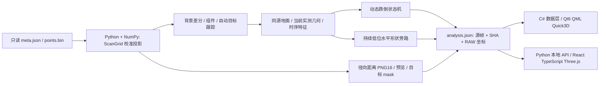

# LiDAR 距离图与已躺倒目标检测

当前优先完成已躺倒形状检测和原有动态跌倒过程检测；跌倒前预测暂缓。三个只读子代理分别分析算法、距离图和界面，主会话唯一写码，OpenCode单独进行用户要求的静态附件审查。审查不是新的开发前置环节。

## 数据流与技术栈

- 算法纯模块在 `src/human_fall_detection/core/`，保持 Python 3.8 + stdlib / NumPy；不增加 OpenCV、权重、训练或 HR-09。
- 离线编排 `pc_apps/range_fall/runtime_replay.py`：完整处理、实际消费序列重跑一致、封存源/账本 SHA后，`analysis.export_run`重新读取同源帧，通过唯一的`ScanGrid.decode`生成共享产物。Qt和Web不重写投影或判定规则。
- Qt `console_v2/app/`：C#读取真实会话、验证帧/点集/图片SHA；点云经单槽共享内存、异步命名管道与ACK。预览PNG通过独立消息字段传输，不进入逐帧日志；Qt深拷贝图像并同步显示。10秒未收到ACK或ACK编号错误会结束连接。开发热重载保留。
- Web `pc_apps/annotator_v2/`：算法建议与标注分开。距离图独立于建议开关，切帧/会话立即清旧图；API只接受已注册结果、固定资源类型与相对路径，并验证源帧和图片SHA。
- Qt实时入口继续只读消费现有板端Foxglove算法，不假称本轮新链已经上板；连接/超时清旧目标和距离图。实时距离图尚未接入。联合录制入口保持显式用户操作，本轮未真实采集。

## 两种判定分别保留

原动态状态机要求实际下降及持续低姿态，未更改门限或放开 confirmed。仅修正“已发生下降但低姿态不足1.5秒”时错误的诊断理由。

新增`core/range_posture.py`复用当前目标的同源地面特征：顶部≤0.7m、水平跨度≥0.6m、非退化PCA主轴竖直度≤0.5、至少15个实测点，并连续同目标源时间≥1.5s，才能输出`lying_candidate`。时间间隔大于0.3s、缺测、跳帧、上下文或目标变化会重启计时。0.3秒边界采用1e-9浮点容差。

这是**躺倒几何候选**，不是人体类别或已证实跌倒事件。PCA主轴是可见点集的主轴；竖直表面、残缺身体、遮挡、视角和同形箱体都限制判定。高度或单帧外观不足以证明人体跌倒。人体语义、真实效果指标继续UNKNOWN；静态候选不会自动写人工标注或新增动态跌倒区间。

上述0.5主轴门是未经过人体GT校准的初始几何设置；其余高度/跨度/持续门复用原规则。不能直接移植其它相机/激光雷达论文的效果或门限。静态躺倒识别作为独立任务也见[Wang等，RSS 2011作者页](https://www.graphics.rwth-aachen.de/publication/0042/)；本文采用独立几何旁路是工程推断，没有使用该论文的图像模型或声称复现其结果。

## 图片方向与导出契约

- 尺寸256×192；径向距离是传感器到回波的欧氏距离，不是相机Z深度。不插值、不补洞。
- `lidar_range_image/2`根据用户观察方向，将**metric / preview / mask统一上下、左右翻转**，等价于原生栅格旋转180°。`nativeTransform=rotate180`，图像像素反查原生栅格：`native_row=height-1-image_row`、`native_col=width-1-image_col`。算法及RAW点集不旋转。
- PNG16数值1…65534为毫米，0无回波，65535为超65.534m；算法仍使用原始浮点距离，不使用量化图。预览红近蓝远，仅0.1…8m截色，远距原始毫米值仍导出。
- mask仅由本帧目标来源行与`ScanGrid.source_rows`精确映射，和距离图同向。JSON侧车保存时间、RAW/标定/文件SHA、像素计数和上述逆映射。
- 旧v1产物只读兼容：Qt/Web在显示时旋转180°，下载保留原生行列；新版v2显示和下载同向，避免双翻转。
- Web资源入口`/api/session/<sid>/depth/<frame>/<preview|metric|mask|metadata>`；Qt“2D距离图”显示同帧预览，“查看导出文件”定位已经生成的目录。

## 已有验证与限制

证据在`docs/evidence/2026-10-25_depth_fallen/`。`oriented386/analysis.json`和`oriented780/analysis.json`为转正后的完整真实会话产物；旧版生成结果只读保留。新距离图和姿态输出按源SHA绑定，不是运行中的实时模型。

386帧实际锁定目标的269个可观测帧均为竖直表面，静态候选0；780帧缺同源地面，姿态全UNKNOWN。两段均不是已验证的跌倒正例。合成正例从原始校准射线→背景→组件→跟踪→姿态→导出可产生候选，但目标为明确非人体的长方体，仅验证软件链。动态下降与静态横卧分别有合成几何测试。不得把这些结果记成人体准确率。

真实人体/跌倒数据效果、非空场启动、视角/遮挡鲁棒性、板端部署和性能、真实USB物理同步、R2独立系统/真正冷机和发行兼容缺口仍保留；本轮不宣称完整项目已经完成。
