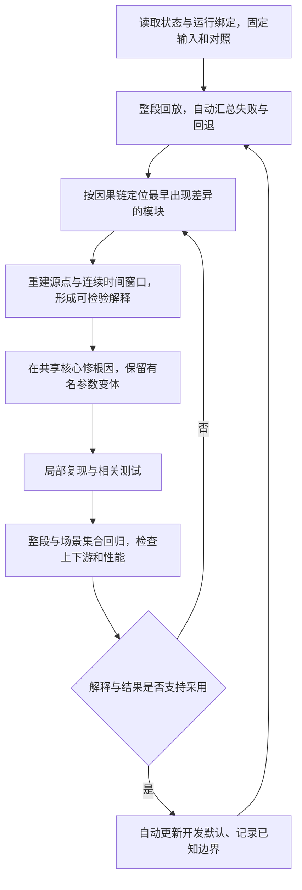

# 人体感知连续开发与调试方案

日期：2026-10-18。工作规则只以 [PROJECT_WORKFLOW.md](PROJECT_WORKFLOW.md) 为准；本文件描述整条产品链如何持续开发、定位和验证，不新增工单、验收表、人工确认或复审环节。

## 1. 要交付的系统

已有原始会话或合法在线输入，经过有效性与坐标检查、前景分离、候选组织、自动获取、连续跟踪，形成一个有来源行和明确可信状态的活动目标；区域和姿态只消费这个目标的实际观测，页面忠实显示核心结果。多候选竞争、观测不足和数据故障时自动拒绝或恢复，不依赖点击选人。

开发需要同时维护三种结论，不能互相替代：

| 结论 | 可以证明什么 | 不能据此宣称什么 |
| --- | --- | --- |
| 软件契约成立 | 来源可重建、版本正确、最多一个目标、预测不作观测、时钟与生命周期正确、回放确定 | 被锁的是人、点集纯净、身份没有切换 |
| 已有场景的几何行为可解释 | 某些点为什么进入/退出目标、哪些连接造成合并、哪些变化来自背景/搜索域/坐标，功能是否回退 | 人体 precision/recall、真实误锁率、跨丢失身份一致 |
| 人体与物理效果有证据 | 在具备相应独立真值或合法物理验证的场景上报告对应效果 | 推广到没有覆盖的场景，或用 PC 耗时替代板端性能 |

前两类工作连续推进，不等人工标注。缺真值时第三类保持 UNKNOWN；缺真值不等于当前失败已经解释清楚。

## 2. 当前基线与必须解决的实际问题

- `run_04` 是已有区域功能的历史对照，包含固定 ROI/旧背景条件；不能作为人体真值，也不能与不同输入条件的新结果直接比较识别优劣。
- `raw_final_v2` 是当前自动目标开发运行，已经有来源行一致性和生命周期证据；它不是已完成的人体识别版本。
- 框宽从 2.195 m 变为 0.954 m，只说明一次几何结果变化。必须检查撑框点的来源与连接，不能据此判定剩余点都是人体。
- 原始目标超出旧区域开发域，267 帧区域全部 UNKNOWN，是明确的功能回退；原因可解释不等于功能已恢复。不能以“区域不阻塞主链”为理由忽略页面能力下降。
- 无显式背景的整段回放均 ambiguous，说明当前策略会拒绝竞争；这不是复杂场景识别人已完成。要分析竞争来自真实多目标、背景残留、候选碎裂，还是几何门设置。
- PC 串行 P95 约 116 ms，源帧间隔约 104 ms；尚无实时余量证明，板端性能 UNKNOWN。

这些问题属于同一条开发主线，需要在同一批可复现运行中同时观察。既不把它们拆成等待用户逐项派工的任务，也不在一次实验中无记录地同时重写所有模块。

## 3. 一次启动后持续执行的闭环

这是 agent 自行执行的工程循环，不是提交给人签字的状态机。用户不需要在每个箭头后说“继续”。局部失败先保留证据并定位，不把所有模块重跑一遍代替思考；局部通过后必须回到完整链路。

开工时读取当前状态和最近进度，记录 branch/HEAD、已修改与未跟踪源码及关键 SHA、输入绑定、运行参数和当前页面绑定。尊重脏工作区，不 reset/checkout/clean。选定一个新的证据根，本次实验所用源码和输入版本有明确对应。

接着用全量可读开发输入生成症状概览，优先处理影响真实目标点集或造成大范围功能回退的最早根因。修复后沿调用关系贯穿所有入口，而不是仅修当前截图。完成一轮可比较运行后自动决定保留或放弃候选，继续处理剩余主要问题；结果和下一步只写状态、进度，不再制造工单。

## 4. 输入和实验如何组织

### 固定实验条件，保留两个作用不同的对照

一个对照保留产品此前能做什么，用于发现区域、页面、状态、旧手动入口等能力回退。另一个对照与候选使用完全相同的原始输入、背景、坐标、搜索域和时间策略，用于识别算法修改本身的影响。旧 run_04 与新 raw 的差别含输入条件变化，不能冒充第二种对照。

同一根因可以需要修改多个调用者和相应测试，不限制为“每轮只能改一个文件”。但背景、搜索域、聚类、获取、区域规则的影响必须能分开解释。必要时做少量有明确问题的消融：例如只换聚类、只换背景。不得遍历大量阈值后只展示最好看的帧。

新阈值写新命名变体，保存与对照的参数差异。5 cm 连通、0.6 s 获取窗都是当前工程起点，不是需要保护的算法结论；它们的保留或修改由跨场景行为与敏感性分析决定。

### 从已有数据构建常用回归输入

只读盘点已有会话的格式、帧数、时间、坐标和可用背景/地面，检查数据是否可运行。场景类别必须有可追溯的内容依据，不能从文件名或锁定状态推定“单人”“无人”“遮挡正确”。已有 386 帧继续作为暴露问题的开发数据，不改称独立测试集。

按可证实的信息组织空场参考、进入/离开、静止、持续运动、低姿态、竞争、碎裂/粘连、遮挡、坏时间、换标定等回归输入。没有对应真实场景的，保留缺口，并用明确标注的合成输入检查软件行为。不要把“24 个会话已列出”写成“24 个场景已验证”。

每次开发保留同一组常用回归输入，并把新暴露的反例加入集合，避免修一帧、坏另一段。场景覆盖不是人工标注前置任务；agent 先检查可读信息和能自动验证的性质，真值不足部分注明 UNKNOWN。

### 保持在线等价

当前帧只使用已提供的参数、明确冻结的背景和此前已经消费的观测。背景预热段必须显式声明，并记录何时开始可用于处理；不得让后面的空场、全会话统计或事后围人 ROI 回流到早期帧。追加未来帧不应改变同一参数绑定下已有前缀的算法输出；完整文件 SHA 变化属于输入版本变化，需与算法输出变化区分。

## 5. 沿整条链定位，而不是追着框调阈值

| 链路位置 | 必须能回答的问题 | 对应诊断与处理方向 |
| --- | --- | --- |
| 原始输入与时间 | 是否同一会话、同一帧、同一来源行？是否重复、过期、回退、丢帧？ | 先查字节/行映射与时间日志；错误输入不进入获取和姿态历史 |
| 坐标与地面 | 点、框、预测和区域是否同坐标？地面版本是否适用？ | 做往返与边界重建，检查标定绑定、有效域和物理资格；不把显示配平当运行认证 |
| 搜索域与背景 | 点是背景残留、被错误背景扣除，还是搜索域变化引入？ | 固定输入比较过滤阶段；记录保留/排除来源，不用围人小框隐藏残留 |
| 组件与目标点集 | 是否有稀疏桥连、投影误并、身体碎裂、背景粘连？ | 查三维连接、局部支撑与连续帧来源；判断问题是否出在组件构造、目标归属或观测不足 |
| 获取与关联 | 为什么锁它？竞争是真实多目标还是前级碎裂？何时丢失？ | 比较全部候选、质量与关联距离；区分获取窗与保持规则，不反复调时间窗掩盖点集问题 |
| 区域、基线与姿态 | 目标正确但域不适配，还是输入本身不可信？旧目标历史是否泄漏？ | 明确域与版本失配，修目标相对/地面相对契约和重置逻辑；不裁剪真实目标凑旧 ROI |
| 页面与 console | 展示是否对应当前运行的当前目标？是否把预测画成实测？ | 核对绑定、来源行、核心/API/页面值；显示不另选簇，不从当前文件临时重算另一套目标 |
| 性能与运行时 | 延迟发生在哪段？是否积压或超时后仍发布旧观测？ | 分阶段计时，分开预热/稳态/故障恢复，检查队列年龄、丢帧与发布年龄，再优化实际热点 |

调试先找“差异最早出现的位置”。下游框变大可能来自上游背景或组件；区域消失可能来自绝对域不适配，不能简单归咎于点数不足。页面截图用来发现和解释症状，不能代替来源点与版本检查。

### 对框和点集的具体诊断

每个异常连续窗口至少重建：全部有效输入、过滤后的前景、全部组件、实测目标点、未选点、区域支撑、框极值点及其来源行。先在 RAW 中确认归属，再以同一变换检查 ground，避免坐标变化误导判断。

为极值点追溯其所属组件、邻接支撑、与目标核心的连接路径和跨帧存在情况。判别是零散点、薄桥粘连、真实连续表面，还是坐标/背景变化，给出支持或反驳当前解释的证据。所谓“目标核心”只是几何诊断对象，不能预设等于人体。

连通不等于同一对象；最大簇不等于人；稳定残留也可能是桌椅；尺寸像人也不是人体分类。反过来，手臂或低密度可见部分也可能与主体暂时分离。组件可以是目标归属的输入，但不能永久把“一个目标”硬编码为“永远一个最大连通簇”。是否允许组合组件，要由唯一关联和明确空间/时间支撑决定；不确定时保留原因并降低观测可信度。

不能仅以减小框宽、固定百分位裁边或强制缩框判断成功。真正修改目标成员时必须让全部计算消费者同步使用新成员，并报告被移除点和新增点；仅改变包围几何时仍须包围所声明的点，并明确几何类型。没有人体点真值时，不把几何诊断写成已确认的人体/背景标签。

## 6. 各模块如何一起推进

开发的顺序由依赖关系决定，并非逐模块做完就永久封存：

1. 先使原始帧、背景/地面和目标成员选择可追溯、在线等价。在这个过程中保留候选集合，不用获取状态替代点集分析。
2. 获取与保持并行使用同一目标契约。初次获取要求支撑、持续性与唯一性；已锁保持允许姿态变低/变宽，处理碎裂和粘连歧义；静止与低姿态不能只因不动或不站立被排除。短遮挡预测独立标记，长失锁重新竞争、新 ID、旧基线清空。
3. 区域模块从绑定目标接收实际点，逐步修复旧绝对 ROI/固定会话假设。保留旧算法在其适用域内的对照，并为新域建立可运行契约，防止修目标后区域全灭。恢复区域不等于恢复解剖关节精度；低姿态超出算法能力时明确拒绝。
4. 姿态与跌倒在可信实际观测之上运行。基线绑定会话、ID、epoch、选择/动作代际与标定，故障时清空或失效；无人体/跌倒真值时 confirmed 继续关闭，不为了让页面亮起而放宽规则。
5. 当前回放、生产核心、ReplayPipeline、WebUI 和 console 同步消费共享策略与输出。手动模式保留兼容；自动模式确实可重获，不只隐藏 requires_reselection 文案。
6. 在实际热点上优化 CPU、内存、输出体积与队列行为，保持相同结果或解释必要变化。PC 与板端分别测量；离线成功不能自动跨入部署、采集或训练。

若纯几何在已有跨场景反例中长期无法区分桌椅与人，先记录具体不可区分条件及其影响，保留 semantic=unknown。之后形成语义分类扩展的技术选择和证据需求；不自行训练、下载模型或开启 HR-09，也不把新增模块设为当前所有软件改进的前提。

## 7. 验证如何贯穿开发

调试时用连续窗口快速验证原因，窗口需包含异常前后的状态历史，不能只截一帧测试获取/遮挡。每个实现增量完成后跑相关 `-B -W error` 测试和一次完整离线回放或端到端，再扩大到常用场景集合。触及页面/console 时增加对应 JS/Python 测试与核心—API—实页对照。

软件回归持续覆盖：空输入/坏帧、静止、进入/离开、竞争、噪点大簇、稀疏桥连、分裂/粘连、短遮挡、长丢失、新 ID、低姿态、重复/回退/无效时间、标定与坐标切换、过期状态刷新。使用合成已知几何检查边界，也用已有真实帧检查开发反例。对网格边界、采样密度和小幅参数变化做有限敏感性检查，防止只在特定体素对齐下成功。

完整回归同时看四个方面：

- **契约与因果性**：来源行可重建，消费者绑定一致，预测不作观测，历史正确失效，重复运行与前缀结果一致。
- **行为与功能回退**：获取/拒绝/遮挡/重获的原因可解释；目标成员变化、极值点变化、区域可用性和页面能力变化逐帧有对照。UNKNOWN 的新增必须归因，不能当通用成功出口。
- **场景覆盖与已知反例**：改善是否仅限一个帧、一段开发数据或一个背景条件；新增失败是否已纳入后续循环。
- **性能与故障恢复**：预热和稳态分开计时，报告每段耗时、P50/P95/max、输入间隔、处理/发布年龄及积压；目标板结论只来自目标板测量。

不设置脱离输入和应用要求的任意“通过率”。来源一致、确定性、版本失效等硬契约必须成立；有显著功能回退的候选保留作实验，不因单测数量多就自动提升为正常默认。应用需要取舍时明确改变了什么能力和为什么，不能把不可用功能从统计中删掉。

## 8. 运行、采用与结果记录

诊断运行只写新的证据目录，不直接改变页面默认。对照与候选的参数、源码和输入都先固定；运行成功结束、所需比较和集成检查完成、主要变化可解释且没有未处理的关键回退后，由 agent 自动更新开发默认。这个采用判断是工程工作，不是新增人工审批。

如果发现当前默认本身已有问题，保留它的运行证据作为反例，自动组织修复和替代比较；不得用 reset/checkout/删除产物回退。可以调整可逆的开发运行绑定，但必须让页面、API、console 指向同一完成运行，写清保留与失去的能力。不得把旧区域和新目标混接来伪造功能恢复。

每次运行的机器记录按当前工具能力持续补齐：

- 运行命令、全部参数、输入/背景/地面/源码 SHA、输入角色及作用域；记录运行代码与当前源码的区别。
- 帧序号/时间、candidate_id、track_id、全部前景/组件及排除原因、target source_rows、实测/预测、坐标/epoch/标定/动作代际。
- 过滤阶段计数、组件连接和极值点诊断、关联与拒绝原因、区域拒绝原因、基线失效和状态转换、各段耗时。
- 对照/候选逐帧差异、新增回退、重复回放、前缀检查、场景覆盖、失败运行及错误日志。
- 页面绑定与 API/实页证据；人体和物理未知项明确保留，不能填成 0。

这些是机器产物，统一放 `docs/evidence/<date>_<topic>/`。本文件规定下一步工具需要提供什么，不宣称上述所有诊断字段现已实现；当前缺少的字段在修对应根因时补齐。不要另写一套验收报告，结论追加 `PROGRESS.md`，当前入口和剩余问题更新 `PROJECT_STATE.md`。

对用户的阶段结果先说明：整条链哪项能力实际改善、还有什么失败、有没有回退；再给必要证据和下一步。不能只报测试数量、框变小、某状态出现，或者每轮重新提出一张待用户批准的任务表。

## 9. 后续开发从哪里连续开始

下一次实现启动后，直接固定当前自动运行和旧功能对照，建立同输入条件的实验对照，生成整段目标成员、极值点、组件连接、区域拒绝和耗时概览。160/183/341 帧是已有反例入口，不能替代整段扫描。

随后沿最早根因修目标归属和残留/粘连，检查获取/保持的反应，并持续修复区域域适配造成的功能回退；同时扩充已有会话与合成回归，最后完成共享核心、页面、console 和性能验证。若证据指向另一模块，按依赖关系调整顺序，不等用户重新派工。

本次只设计和记录流程，不改变算法、阈值、LATEST 或设备状态。接下来实现时按上述闭环持续做完已授权的软件范围；板端部署、现场采集、训练和权重下载仍遵守 PROJECT_WORKFLOW 的明确边界。
