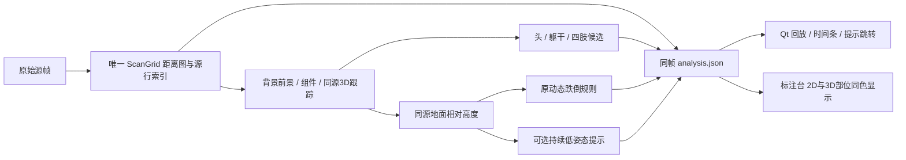

# 同源目标、部位与低姿态提示的集成入口

2026-10-26。本机离线集成入口为 `console_v2/start_integrated_preview.cmd`，每次启动构建当前 Qt/C# 源码，注册本轮 386/780 两份完成结果，默认打开 780 第 690 帧。结果缺失时明确失败，不回退到旧结果。独立标注存储为 `pc_apps/annotator_v2/flow_store_dev`；源会话和旧标注不改。

## 一条目标链，三个消费者



- 部位算法不重新选目标，不作为低位提示的必要门。低姿态下部位无法解析时仍可给出有依据的高度提示。
- 重的部位分析在结果导出时预计算。Qt 只接收已校验的部位点数；完整 2D/3D 部位着色在网页标注台，按同一会话/帧打开。网页新页面无已保存部位时直接显示预计算候选，保存前不写标注；已有手工部位保留。
- 动态 `state` 与 `groundAlert` 分开。后者只输出持续低姿态，蹲/坐地也触发，不是跌倒事件，不会写成 `confirmed`。建议采用到标注时标签为 `sustained_low_posture` 动作，不能冒充 `suspected_fall`。
- 780 的低位段为 f674–707；达到 1.5 源秒的首次提示是 f689。f674–688 显示观察中；f708 清除。时间条表示已完成离线分析的区间，点击跳到触发帧，不能把段首解释为实际发报时间。
- 突变、跳帧、时间回退/非有限、超过既有 0.3 s 缺口、目标/代际/绑定变化与缺测会中断累计。提示使用同一目标的高度，不拼旧目标或预测点。

## 重建完成结果

以下仅在本机读取已有会话，输出必须选择新的目录，不能覆盖历史 evidence。示例 `NEW` 是新建的工作输出根。

```powershell
python -B -W error pc_apps/range_fall/exp_2d3d/ablate.py fit-ground --session data/sessions/cap_20261017_113516 --out NEW/ground780
python -B -W error pc_apps/range_fall/runtime_replay.py --session data/sessions/cap_20261017_113516 --out NEW/run780 --empty-prefix-frames 50 --ground NEW/ground780/BOUND_GROUND.json --no-detail --alert-variant ground_alert_v1 --body-candidates
python -B -W error pc_apps/range_fall/runtime_replay.py --session data/sessions/cap_20261018_110029 --out NEW/run386 --empty-prefix-frames 50 --ground docs/evidence/2026-10-23_range_p0_w2/BOUND_GROUND.json --no-detail --alert-variant ground_alert_v1 --body-candidates
```

普通运行默认不开新提示和部位预计算；原跟踪/动态规则不变。运行完整消费序列复算、源/账本 SHA 校验成功才生成 analysis。源节奏检查追加 `--paced --speed 1`，另选新输出目录。导出阶段开销写 `EXPORT_TIMINGS.jsonl`，不混入运行中的算法耗时。

## 实时仍缺哪一段

当前实时 Qt 继续订阅原始点云和旧 `/single_target_live/state`。本轮新增直接显示识别输入失效原因与点云年龄，避免“画面流畅”掩盖识别断流。板端订阅 guard 本地修复增加“连接数非零但回调沉默”的重建，仍复用原 10 s 重试间隔；收到回调即可保持，不按算法速度重启订阅。该修复尚未部署。

要完成现场实时，需要在明确授权板端运行后：恢复并验证订阅；将相同 ScanGrid/前景/RangeTracker/高度与 GroundAlertObserver 接到连续源帧；为当前安装建立实际适用的地面和明确的空场背景；输出完整源 header、索引、目标、深度与失效原因；Qt 同帧消费。离线会话的地面/背景绑定不能直接用于现场，距离图转换进程也不等于目标识别进程。

显示与计算继续使用有界队列：原始场景按源节奏显示；算法保留最新待处理帧并记录覆盖；部位分析独立，延迟/缺失不挡主目标与低位提示；跨源帧的旧目标或部位不覆盖新帧。UI 保持现有 ACK/TTL/完整 header 约束。

现场新链、板端恢复修复和实时部位传输本轮均未部署或启动；本机通过不能称为现场锁人成功。人体类别、部位/姿态准确性、实际跌倒识别、物理地面有效性和现场端到端性能仍 UNKNOWN。无采集、训练、权重下载或 HR-09。

## 本轮实测

最终780源节奏仿真完整处理780帧、0覆盖，循环P95 63.259ms；与完整结果逐帧相同。原生播放阶段9.645fps，95帧同源点云/目标/距离图复制ACK一致。初次覆盖10帧的失败记录保留；旧G1/G2更严门及f360问题没有宣告关闭。核心814（1 ROS跳过）、range55、body/server26、Web97和原生集成检查完成。证据见 `docs/evidence/2026-10-26_unified_flow/CHECKS_FINAL.json`、`PERFORMANCE_FINAL.json`、`NATIVE_CADENCE_FINAL.json`。
