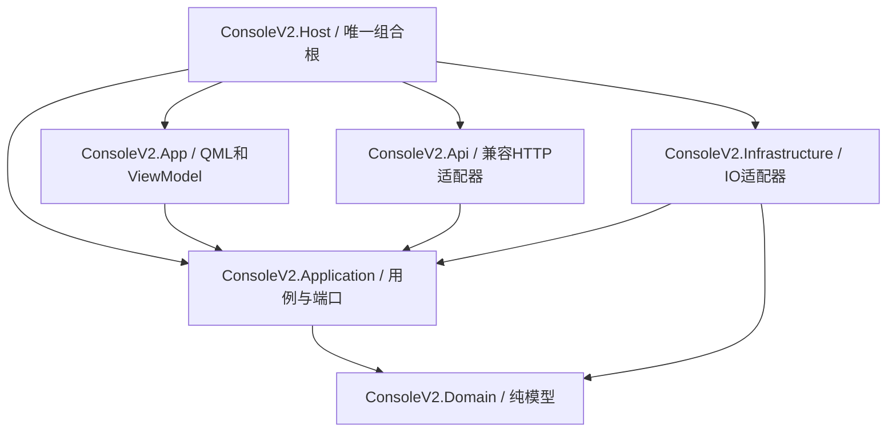

# ConsoleV2 R1 架构

2026-10-24。状态：设计完成，业务未实现；A 路线为 R2 待验证候选。本文不授权修改旧控制台、真实数据或设备。[R0事实](FACTS.md)与[旧API行为基线](API_CONTRACT.md)继续有效；本文不能把契约冲突自动批准为兼容例外。

2026-10-25 R2追加：固定发布版A绑定加载失败，已选Qt C++宿主+C#服务B；本机渲染/解码/单文件包已有实测，独立干净系统与真正全冷启动仍未验证，见[SPIKE](SPIKE.md)与[ADR-001](ADR/ADR-001-technology.md)。以下六程序集是产品逻辑边界；B由原生Qt宿主拥有QML，另一个C# Host组合Application/Infrastructure/Api，跨进程连接替代同进程Qml.Net引用；原生界面经桥接VM调用用例端口，Domain不引入IPC或Qt。R2临时程序不是这些业务程序集的已完成实现。

## 1. 编译依赖与职责

2026-10-25 用户补充目标：控制台须方便迭代。后续功能按实际 feature 组织，业务可独立于Qt运行与测试，算法经适配器输出统一展示数据，日常目录运行与正式单文件打包分开；不为此增加通用插件框架或空工程。当前统一开发入口与具体修改位置见[开发与迭代](DEVELOPMENT.md)。

箭头表示编译引用，不表示运行时调用。先规划六个程序集；不为每个 feature 创建空工程。R1只交付文档，不创建解决方案或接口占位实现。



| 项目 | 内容 | 禁止依赖/行为 |
|---|---|---|
| Domain | SessionMeta、FrameIndex、PointLayout、BoardSession、Annotation、纯几何及领域错误值 | 无项目引用；无IO、Qt、HTTP、DI、日志宿主 |
| Application | 用例、Result、六个稳定端口、回放时钟/调度状态、取消和授权编排 | 只引用Domain；不new具体文件/网络/Qt适配器 |
| Infrastructure | Data、Replay缓存、Capture、Leveling、Annotation、配置/日志适配器；受控Python调用 | 引用Application/Domain；不引用App/Api，不包含公共兼容HTTP路由 |
| Api | v1 wire DTO、状态码/Content-Type/错误映射、安全路由策略、静态资源、v2协议 | 只调用Application；不直接读文件、代理板端、启动Python或绕过Gate |
| App | QML、ViewModel、Qt Dispatcher、NativeGeometry渲染桥 | 引用Application；不直接发HTTP、读会话文件或解码原始点云 |
| Host | Program、配置加载、DI注册、API与Qt生命周期；B时可headless | 唯一可同时引用各外层的项目；不实现业务或协议规则 |

Host拆出是为了让App→Application的限制在项目引用上可检查。Data/Replay/Capture/Leveling/Annotation先是Infrastructure中的模块；只有出现独立发布/替换需求再拆程序集，不影响六个端口名称。ASP.NET宿主装配由Host调用Api提供的注册入口；HTTP服务实现不再同时归属Infrastructure。

运行时调用：QML命令→ViewModel→Application用例→端口→Infrastructure。HTTP请求→Api wire映射→同一用例。二者共享状态、根目录和Gate，不自发HTTP绕一圈；客户端能力由Application通过IBoardClient及独立的兼容HTTP客户端适配器获得，前端不拿HttpClient。后者只消费协议、无路由注册，位于Infrastructure，不能引用Api程序集。两种入口对同一个请求必须触发同一个业务用例。

## 2. 进程与端口

- **A候选**：ConsoleV2.exe（Host）承载.NET用例、兼容API、Qml.Net Qt事件循环；一个小型C++ Geometry插件只接收渲染缓冲，不拥有业务、QML宿主或数据目录。Qt6/.NET8/Qml.Net是否能共同加载仍UNKNOWN。
- **B备选**：Qt C++进程拥有QML宿主与渲染；C# Host以headless服务运行，仍独占API、会话数据、Gate和受控worker。命名管道控制消息与共享内存帧租约跨进程，禁止逐点JSON传输。切换依据写ADR-001并由R2实证，不因本机缺SDK就把A记成性能失败。
- **固定默认**：兼容监听127.0.0.1:8901。不随机退端口、不抢占/停止旧服务、不凭端口存在就接管。冲突时显示占用错误和显式配置入口，兼容服务状态为不可用；旧书签继续访问旧服务。用户显式配置另一个端口才允许双实例并行，不能宣布旧8901书签已切新服务。
- 回放根页面和历史静态资源路径保持；联合录制JSON/preview/camera路由也在兼容监听器注册，联合页用独立静态路径避免抢`/`。旧联合服务原本是随机端口，外部书签依赖旧端口时仅“新8901有路由”不证明书签兼容；必须列在R7页面矩阵。
- 监听就绪与UI可交互分别打点。服务绑定失败不显示“兼容正常”；UI可以展示只读错误说明，但不能发起写用例。初版产品配置仅允许127.0.0.1，非环回配置启动拒绝；不借“只禁写”暴露会话/GT/原始点云。未来对外监听另设认证/读取权限设计并登记兼容差异，当前不发布该能力。BOARD_MODE与非环回请求的拒绝策略仍需隔离fixture验证，不能把Origin当身份认证。

## 3. 关键端口草案

以下为设计签名，未编译、未发布；业务实现前需R2决定具体Qt桥。端口位于Application，领域值对象位于Domain。所有失败由Result中的稳定ErrorCode表达，不用bool表示成功。HTTP wire错误文本/状态由Api按v1 oracle单独映射，不把内部Result直接序列化。

```csharp
public interface ISessionRepository {
    Task<Result<IReadOnlyList<SessionSummary>>> ListAsync(SessionScope scope, CancellationToken ct);
    Task<Result<SessionHandle>> OpenAsync(string sid, CancellationToken ct);
}
public interface IPointsSource : IAsyncDisposable {
    int FrameCount { get; }
    ValueTask<Result<IFrameLease>> ReadFrameAsync(int index, CancellationToken ct);
}
public interface IFrameLease : IDisposable {
    FrameIndex Index { get; }
    PointLayout Layout { get; }
    ReadOnlyMemory<byte> RawBytes { get; }
    Result<IFrameLease> Retain();
}
public interface IReplayClock {
    double PositionSec { get; }
    Task<Result<PlaybackSnapshot>> SeekAsync(double seconds, CancellationToken ct);
    Result<PlaybackSnapshot> SetSpeed(double multiplier);
}
public interface IBoardQueries {
    Task<Result<BoardStatus>> GetStatusAsync(CancellationToken ct);
    Task<Result<RecordingState>> GetRecordingAsync(CancellationToken ct);
    Task<Result<IReadOnlyList<BoardSession>>> ListSessionsAsync(CancellationToken ct);
}
public interface IBoardClient : IBoardQueries {
    Task<Result<RecordingState>> StartAsync(string idempotencyKey, MutationPermit permit, CancellationToken ct);
    Task<Result<RecordingState>> StopAsync(string idempotencyKey, MutationPermit permit, CancellationToken ct);
    Task<Result<DownloadReceipt>> DownloadAsync(DownloadRequest request, MutationPermit permit,
        IProgress<TransferProgress> progress, CancellationToken ct);
}
public interface IGtQueries {
    Task<Result<GtSnapshot>> LoadAsync(string sid, CancellationToken ct);
}
public interface IGtStore : IGtQueries {
    Task<Result<GtReceipt>> SaveDraftAsync(GtWrite request, MutationPermit permit, CancellationToken ct);
    Task<Result<GtReceipt>> FreezeAsync(GtFreeze request, MutationPermit permit, CancellationToken ct);
}
public interface IMutationGate {
    Task<Result<MutationPlan>> PlanAsync(MutationRequest request, CancellationToken ct);
    Task<Result<MutationReceipt>> ApplyAsync(MutationPlan plan, ConfirmationToken token, CancellationToken ct);
}
// 仅Gate持有此执行端口；不注入VM、Api或普通用例。
internal interface IMutationExecutor {
    Task<Result<MutationReceipt>> ExecuteAsync(MutationPlan plan, MutationPermit permit, CancellationToken ct);
}
```

Result<T>、SessionHandle、MutationPermit等均是待实现类型，不是已有API。内部接口在首个实际发布版本后只增不改；这里替换提示词中的裸memory/bool风格签名属于发布前设计，不假称保持了已发布ABI。

- SessionHandle代表只读打开的会话和源绑定，不暴露任意可写路径。SessionRepository不做“读失败自动修复”。v1列表保留旧28B筛选；v2完整性列表可显示16B、不完整、损坏及原因，不能把v1字段缺省补成null。
- 普通查询用例只注入IBoardQueries/IGtQueries的只读facade，完整IBoardClient/IGtStore只装配给执行器；不将完整对象当只读接口传出再依靠调用者自律。该分离用于编译边界与正常代码防误用，同进程恶意注入不在安全保证内。
- IFrameLease每个实例是一个独立拥有权句柄；Retain成功返回共享同一后端的新句柄，原句柄和新句柄分别幂等Dispose，禁止把同一实例当成多个拥有者共享。RawBytes仅在本句柄未Dispose时可用；源DisposeAsync标记closing并拒绝新读/Retain，等待全部独立句柄归还后才解除映射。关闭等待超时由Host记录泄漏并停止新任务，不强行解除仍在使用的映射。缓存淘汰只Dispose自己的句柄。**零拷贝只指磁盘映射帧视图，不保证CPU解码、Qt QByteArray或GPU上传零拷贝。**
- 回放时钟由单调时钟和源相对时间驱动，不用墙钟。顺序回放保序并施加背压，不以latest队列吞帧后宣称1×零丢帧；seek允许取消过时代次，必须分别统计读取、提交、呈现和取消。相机近邻仅显示接收时间配对，物理同步UNKNOWN。
- 下载端口是权威fetch的协调器，不重写数据面状态机；IGtStore/IBoardClient写方法只由Gate拥有的执行器调用，普通用例不获取permit。调用链固定为用例Plan→可信确认→Gate.Apply→Gate验证/锁定/签发permit→IMutationExecutor.Execute→受限写端口→Receipt→Gate审计与返回。执行器按动作枚举dispatch，拒绝未知动作，不接受任意委托、shell命令或路径回调。IMutationExecutor由Application定义为内部端口，仅向Infrastructure执行器和Host组合根提供受控程序集可见性；可见性不是恶意同进程代码的隔离墙，底层还校验Gate签名和动作范围。API/VM只能拿到Gate与读端口，不能调用Execute或写端口。

## 4. 数据流、线程与写入边界

OpenSession用例异步读取meta/校验布局与长度→打开只读points映射→生成帧索引和临时源绑定→请求帧租约→后台投影到渲染顶点布局→Qt Dispatcher提交缓冲→Qt复制完成归还输入显示句柄，呈现事件另外计时。UI线程不哈希、读盘、等待worker或遍历50万托管点对象。每个阶段带sid/frame/generation与单调时间戳；R2测真实复制次数和耗时。

1GB首帧不等待全points SHA扫描：临时绑定含meta_sha、文件身份/长度/修改时间，状态为Provisional，首帧另记切片SHA；完整points SHA在受限后台任务计算后才能变Verified。Provisional不能冒作完整性通过、不能驱动GT冻结/变更/导出源绑定，旧API需要完整SHA的manifest仍等待实际全量计算。打开到首帧和全量核验耗时分别记录；仅文件属性不构成内容未变证明。来源变化或无法稳定只读打开时变Stale并停止相关提交/写计划，R3需验证共享句柄与外部写者的拒绝策略。

上述释放须区分源租约和渲染缓冲：投影完成即可归还该worker的源帧句柄；VM只接收元数据与IVertexFrameLease显示句柄，不获得IPointsSource/RawBytes。显示和缓存通过Retain持有独立句柄。桥接受提交时转移一个显示句柄的拥有权；Qt线程先复制到**Qt拥有的QByteArray**，发CopyCompleted(submissionId,generation)后归还该句柄。未采用fromRawData/外部指针零拷贝，因此归还点不依赖GPU fence；GPU使用的是Qt副本。Presented是独立计时/计数事件，不能用CopyCompleted冒充首次呈现。拒绝/取消/Qt关闭也由桥恰好归还一次，迟到回调按submissionId和代次忽略；以后若引入外部指针或共享槽免拷贝，必须新增实际消费完成fence协议再测，不能沿用复制完成归还规则。

显示用XYZ/颜色缓冲与原始28B/16B布局分离；timestamp@20与ring@16不得误当7个float。NaN/越界在解码层诊断，不原地修补，显示过滤需显式计数与来源索引。原始文件始终只读。缓存以字节预算约束，保留租约计入在用字节，不能只按帧数估算。

所有会话/GT/job/导出/下载/录制等数据修改和板端状态变更经Gate；普通日志、配置、诊断与缓存写入仅在应用自有目录，由对应基础设施管理，不获得会话写权限。Gate自身审计写入不递归调用Gate。IO实现只能执行Gate授予的具体permit，不能把“依赖注入了Gate”当作已防绕过。

数据变更统一Plan→用户授权Token→Apply；新增产物没有旧对象可隔离，直接在新目标暂存并校验后提交，覆盖/移动才涉及旧对象隔离。此为**按动作解释**，不是“所有新文件必须先搬进隔离区”的实施承诺。删除/隔离必须先展示sid/path/bytes/sha256逐项清单并获得该操作的明确确认，普通POST本身不等于确认；运行开发也不等于授权真实数据操作。不能以ADR替用户签发token。详细状态机、失败恢复与跨盘限制见ADR-005。

受控写worker是未实现的能力门：固定SHA/参数不提供写入隔离。Gate的worker执行器在隔离能力未验证时返回UnsupportedIsolation，**不启动任何有数据/板端修改能力的Python worker**。这保留R6/R8功能缺口，不把应用层约定叫作已经满足唯一写入者要求。启用条件见ADR-004；R2的本机只读spike不依赖这些worker。

## 5. 兼容、能力与不可同时满足的条款

API_CONTRACT保持旧行为基线，不能通过更新Golden掩盖行为差异。独立Api层有v1 wire DTO和状态映射，v2协议独立，新增`GET /api/version`按目标自报。v1每条路由保留登记位置，包括当前禁止实施的危险路径，但**登记不等于已兼容实现**。

| 冲突 | 安全设计 | 当前兼容状态 |
|---|---|---|
| 旧delete直接rmtree/板端DELETE；新要求无直接删除 | 不实现直接删除；拟在V2拒绝该危险操作，隔离/恢复仅走v2显式计划与确认 | LOCAL_SUCCESS_COMPATIBILITY_BLOCKED；不能自行批准403代替旧200 |
| rename/save_annotations写meta；新要求源meta只读 | 源meta保持只读，暂不实现该v1写路径；v2别名/标注可另存受控store但不能冒充v1存储语义 | STORAGE_SEMANTICS_BLOCKED；不得返回伪成功/伪meta SHA |
| 非环回全部破坏性POST禁用；旧GT/配平/validation有可写入口 | 新设计非环回/BOARD_MODE破坏性POST统一403，旧GT等放行差异必须单列 | REMOTE_POLICY_COMPATIBILITY_BLOCKED |
| 自动worker/旧页面POST与显式Gate确认 | 每次实际变更需要绑定计划的可信用户授权；旧页面无新授权上下文时不得写 | AUTHORIZATION_COMPATIBILITY_BLOCKED |

这些是相互冲突的原始要求，不是已经批准的例外。R1架构可完成，R2只读技术验证可继续；**R7全兼容和R9迁移通过在这些条件下不能宣称达成**。后续只有用户明确选择调整哪条原始要求，才能更新相应契约并保留旧基线/失败对照；本轮不要求用户先答复，也不阻塞不依赖该决定的开发。

## 6. 配置、取消、错误与诊断

配置和日志见ADR-006。配置启动校验失败只展示诊断，不创建数据根或改junction。单写入者锁绑定规范化数据根和store根；API进程/旧Console不共享写许可，R0没有证明旧程序会遵守新锁，因此共用数据根时新程序只读，不能声称新锁可阻止旧进程写入。

取消在校验/读取阶段立即终止；进入原子提交前检查token/源绑定，提交中断返回可恢复的journal状态而非假成功；UI退出先停止新用例、取消预取、等待租约/worker收敛、停止API，再释放Qt。worker终止不能隐含板端stop或recover，状态不明时报告Unknown并仅查询；不自动操作设备补偿。

业务失败值区分InvalidInput/NotFound/Conflict/Unavailable/Unauthorized/Cancelled/IntegrityMismatch/Indeterminate；异常堆栈保留结构化日志，不泄露令牌，不将错误自动吞为false。v1需要的原文error与HTML错误另按oracle映射，不能使用ASP.NET默认ProblemDetails替代。

## 7. R2与后续验证输入

- R2先验证.NET8 SDK与Qt工具链可用性，记录命令/路径/版本/哈希；本轮`dotnet --list-sdks`为空，仅见8.0.14运行时，不能构建。没有测到Qt缺失，只是尚未完成工具链盘点。
- R2绑定/加载→指定真实会话3帧逐值解码→实际约5万点动态提交→500000点明确标注构造方式的压力测试→发布exe与干净运行环境。A失败记录分类原因后按ADR切B，C仍需用户书面同意；任何未运行门记NOT_RUN，不写FAIL数值或PASS。
- R2必须测50万点≥30FPS、约5万点≥60FPS、冷启动10次P95≤2.5s、UI阻塞P99≤16ms、高DPI、进程峰值内存、包体积、无VS运行。单文件exe与Qt插件资源解包单列，不能用开发机目录运行代替。完整1GB首帧/seek/386帧0丢帧留R3/R4/R9实测，R2也保留可复用计时入口。
- R3查解码/路径/租约生命周期；R4查计时、背压和seek；R6查真实板端幂等/下载能力（本轮无设备操作）；R7查HTTP字节/JSON/错误和旧页面；R8查GT格式、并发SHA与产物不覆盖；R9逐项报告不能达成的原要求。每阶段保存机器证据，不用设计文档替运行证据。

## 8. ADR索引

- [ADR-001 技术路线](ADR/ADR-001-technology.md)
- [ADR-002 点云渲染与帧租约](ADR/ADR-002-rendering.md)
- [ADR-003 API兼容与版本化](ADR/ADR-003-api-compatibility.md)
- [ADR-004 进程与服务拓扑](ADR/ADR-004-processes.md)
- [ADR-005 数据安全闸门](ADR/ADR-005-mutation-gate.md)
- [ADR-006 配置与日志](ADR/ADR-006-config-diagnostics.md)

## 9. 本轮验证与审核状态

本轮旧Python11项、4组JS以及真实会话列表→meta→完整points流式SHA/三帧解码通过，54份会话文件和11份受查旧源码SHA保持；与R0的真实只读端到端输出完全一致。8份架构/契约/ADR文档的本地链接与代码围栏检查通过，未编译接口草案，未测新栈、渲染或Gate实现。

按用户要求的[OpenCode首轮报告](../evidence/2026-10-24_console_v2_r1/OPENCODE_REVIEW_01.md)完成并提出设计问题；已补Gate内部执行链、可信确认路径、独立Retain句柄/Qt拥有副本的归还协议，并将非环回监听与未验证的写worker能力关闭。源绑定Provisional/Verified/Stale、首帧与全量SHA的阶段划分也已明确。

修改后的OpenCode复核返回401 `api_key_expired`，没有审核结论，不能宣布“修正已独立复核通过”。修正处置与本会话核对见REVIEW_RESOLUTION.json、AUTHOR_DESIGN_CHECK.json；原始错误与实际模型/会话记录在`docs/evidence/2026-10-24_console_v2_r1/`。R1设计交付完成，独立复核未完成；原C1-C5契约冲突、R6/R8隔离/续传能力与R2技术可行性仍分别未解决。这不阻止下轮只读R2环境准备和spike。
