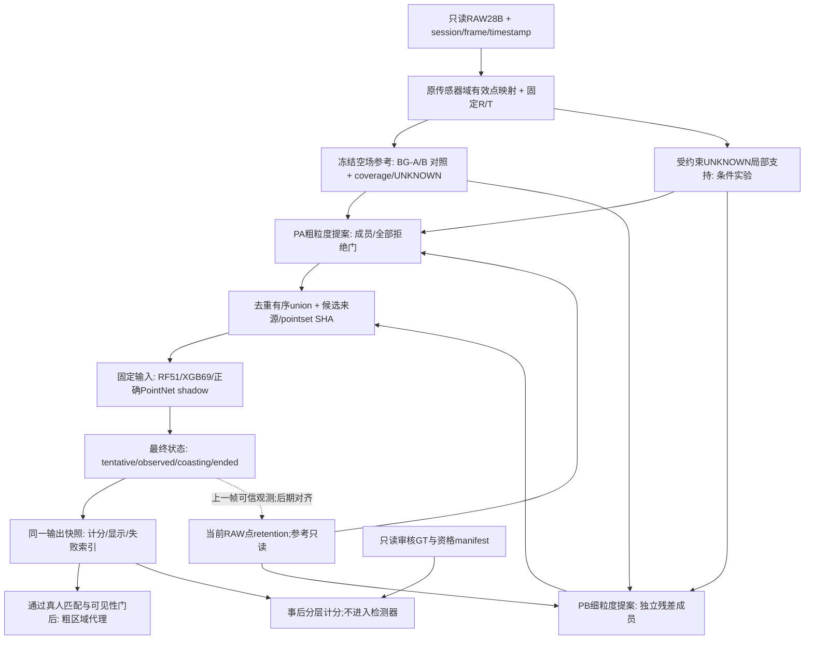

# 人体融合统一开发计划与算法架构

**v2 · 2026-10-11 · HUMAN-FUSION-UNIFIED-PLAN · 当前仅规划/只读审核**

v2修订：补全旧基线会话表，统一PHY01命名，说明真实retention调用链，将retention点送回提案入口，明确无工具probe与只读审核权限。v1冻结件与首次独审保留；[意见逐项处理](evidence/2026-10-11_human_fusion_unified_plan_r1/REVIEW_RESPONSE_01.md)记录两项未采纳的事实判断及源码依据。规划验收标准仍为v1，算法目标未降低。

本轮用户指令：“归一开发进度，根据总结制定修改优化开发的计划算法架构，多轮仔细制定完善，然后 opencode 审核”。本文件归并 CC 阶段一～三、Demo V2、BG V3 和诊断报告；本轮不实施下列算法任务。当前唯一验收表为 [规划验收 v1](HUMAN_FUSION_UNIFIED_PLAN_ACCEPTANCE.md)，[工单](tickets/HUMAN-FUSION-UNIFIED-PLAN.md)，[回传](returns/HUMAN-FUSION-UNIFIED-PLAN.md)。

主路线：**保留 V2 XGB69+Unique 作为研究对照，先修测量与数据契约，再把 BG-B 接入隔离全链，分别优化混合/稀疏候选、困难负例分类及轨迹生命周期；粗骨架后置。** 判断依据是当前实测检测、误检、漏检与身份稳定性，不是背景蓝点、单候选分数或节点 valid 数。

## 1. 授权、版本与三轮设计记录

- 本轮写入：本规划工单、当前入口新增一节、新 evidence 和追加回传；审核者 OpenCode 只读。无活动生产代码 writer。
- 生产/研究旧源码、当前模型、当前 GT、captures、旧 evidence 保持只读；不部署、不采集、不提交推送、不改驱动网络、不激活 ML/HR-09。
- 后续任务均 PLAN_RECORDED / NOT_RUN；需要用户后续实施指令及各任务自己的唯一验收表。人工审查工具可以生成 UNKNOWN 待审包，但不能替用户签 human/reviewed。
- HFUS-Dxx 沿用诊断任务书的研究任务名，记录仍属 HC/HR 研究支线，不是 HF/GL 里程碑授权。
- 基线 master / `026e06303f60ed1bbe4ddc4d037836db68da6d27`；[12412 文件全树快照](evidence/2026-10-11_human_fusion_unified_plan_r1/BASELINE_BEFORE.json) 包含 ignored/untracked，排除 .git 内部、不遍历目录符号链接；零读取错误、零读取中漂移。树本来不干净；保护的是本轮工作树 SHA，不宣称等于 HEAD 全内容。
- ponytail 实际读取路径 `C:/Users/30680/.codex/skills/ponytail/SKILL.md`。优先现有 JS/Python/stdlib；当前不引入新检测框架、训练库或板端依赖。

三轮逐次修订记录：[第一轮事实归一](evidence/2026-10-11_human_fusion_unified_plan_r1/ROUND_01_RECONCILIATION.md) → [第二轮架构/依赖](evidence/2026-10-11_human_fusion_unified_plan_r1/ROUND_02_ARCHITECTURE.md) → [第三轮反例/验收](evidence/2026-10-11_human_fusion_unified_plan_r1/ROUND_03_ADVERSARIAL.md)。先完成作者三轮，再由 OpenCode 独立审核；审核意见和修订另存新文件，不覆盖第一版提交证据。

## 2. 当前进度归一：已实现、可验证与未闭合

以下为已有证据与本轮源码核对，不是本轮重新运行算法或浏览器。统一依据 [CC 总结](evidence/2026-10-11_cc_mainline_r1/03_SUMMARY.md)、[V3 交付](evidence/2026-10-11_human_fusion_bg_v3_r1/REPORT_FINAL.md)、[诊断报告（含 §12 修正）](evidence/2026-10-11_human_fusion_diagnosis_r1/REPORT.md)。

| 模块 | 当前可确认进度 | 仍缺什么/下一步 |
|---|---|---|
| Demo | V1/V2/V3真实回放和诊断资产存在；V2已有成功/漏检/家具/静止截图 | 不重建 Demo；最终集成后追加失败索引。旧端口在线属于历史实测，本轮未探测 |
| 输入与候选 union | lab公开点集/count/bbox已与评分union同步；生产human_core仍缺该段 | 隔离基线复用lab；生产回流另单 |
| 同帧唯一 ID | V2 fixedDetector 每次 tick/reset强制 Unique；裸V1默认仍为旧 tracker | V2不重复修；默认入口统一/生产回流未做，S9身份质量BLOCKED |
| 确认票 | CC纠正后真实votes违反=0 | 不安排“投票大量错误”返工；frame/time契约另测 |
| geometry(post) | 当前同口径6520候选显示mismatch=0 | 内部仍先走RF关联/retention；不能当纯几何状态基线 |
| BG-B | 空场冻结容差体素改善已标人体点保留 | V3仅切mask，未接检测全链；S6最终收益NOT_RUN |
| S6 | A链f187/f188前分类缺参考删除有直接证据；稀疏帧存在19～36点支撑 | B-f128人体15点已进大簇，需测混合簇纯度/score，不能套用“15<60”单因果 |
| 分类 | A链XGB比旧RF明显降FP；B家具608候选误判595 | 候选域脆弱已证实；“仅位置记忆”未唯一证实；独立家具泛化UNKNOWN |
| PointNet | 模型和ONNX存在；正确中心化test58/65、stress39/58 | V3评测消费者仍漏中心化；修工具，不按错误表淘汰模型或重训 |
| GT/数据 | 2605帧中814具当前评测资格，510 PERSON观察；其余1791帧UNKNOWN | S4/S5/S7/S8连续覆盖不足；val/test/stress无有效负例；S9草稿非GT |
| 粗骨架 | confirmed候选接observe，近走可出4区域节点，跨度0.8m门影响有效率 | 候选confirmed不等于真人；区域代理不是关节；人工区域/HEAD、物理校准缺失 |
| 姿态/跌倒 | ROS已有fall_state；lab pose_history未形成有效事件链 | 真跌倒/ADL/身份/地面证据BLOCKED；不能写“整个仓库零实现” |
| 板端/生产 | 本轮没有运行 | D01 NOT_RUN；PHY01 BLOCKED |

不继承旧计划里“Q01仍98.7%不一致”“骨架真人节点全0”“S9完全没有标签”“整个项目跌倒0实现”等过期或过宽判断。旧文档保留，以新归一表限定当前状态。

### 2.1 同口径研究对照

冻结 V2：BG-A envelope、当前PA/PB、XGB69、Unique、0.35候选/0.55强票、5帧3票与min_age=3、0.75m XY一对一评测。该数字为诊断报告历史18份输出重算，后续先按当前SHA重放确认，不强制不相容版本复现。

| 会话 | 已标PERSON观察 | accepted候选 TP/FP/FN | legacy当前confirmed TP/FP/FN |
|---|---:|---|---|
| S1 | 0 | 0/0/0 | 0/0/0 |
| S3near | 258 | 258/19/0 | 256/9/2 |
| S3far | 99 | 99/97/0 | 97/93/2 |
| S4 | 11 | 11/9/0 | 10/8/1 |
| S5 | 6 | 6/0/0 | 5/0/1 |
| S6 | 71 | 65/1/6 | 61/1/10 |
| S7 | 12 | 12/1/0 | 11/1/1 |
| S8 | 53 | 53/0/0 | 51/0/2 |
| 全部有资格开发切片 | 510 | 504/127/6 | 491/112/19 |

这里候选统计已过分类，不是 classifier前proposal召回；FP是旧距离计分未匹配次数，非已证明的独立家具报警数。其他会话的非穷尽GT不能把全部unmatched直接视作真实FP。S6是已暴露开发回归集，九会话整体均非新盲测。

### 2.2 BG-B点级收益采用实际JSON分母

| 会话 | 有效GT PERSON点数 | BG-A损失 | BG-B损失 |
|---|---:|---:|---:|
| near | 286822 | 12.15% | 4.58% |
| far | 561361 | 7.24% | 3.98% |
| S4 | 13327 | 10.05% | 2.92% |
| S5 | 8841 | 9.70% | 3.00% |
| S6 | 27268 | 55.55% | 7.79% |
| S7 | 24361 | 13.57% | 4.90% |
| S8 | 57045 | 17.27% | 2.04% |

S1家具7220011点，A保留174472、B保留171958，差约0.04个百分点；S1没有人体，不能说“8个人体会话全部改善”。旧V3正文near31335/S65062分母不沿用。[实际补充JSON](evidence/2026-10-11_human_fusion_diagnosis_r1/late_review.json)。这些池化点率不证明独立样本统计显著性、全部静止人不会被背景匹配删除，或最终漏检已修。

## 3. 目标算法架构：一份点集契约、逐层实验、最终统一状态

图示为目标架构，不宣称当前已实现。用BG-A/B/C表示背景组，PA/PB表示两种proposal；两套A/B名字不混用。

### 3.1 数据与坐标

复用现有data_loader、leveling、rawMap。原始28B行索引、GT compact有效点索引、leveled xyzi索引三者显式区分；有效点先在原传感器域筛选再R/T，防止原(0,0,0)经平移后变非零。每层保留 `(sid, segment, frame_index, timestamp_s, raw_row_index)`；读错索引域即工程FAIL。

每次运行冻结全部imports、模型/feature/preprocess/config、GT/参考/输入SHA与输出定义；元数据或参考R/T不符则BLOCKED，不自动nominal-fit。RAW无有效点、NaN/Inf、帧重复/逆序、seek、gap/reset都输出原因。

### 3.2 背景与可见性

先复用V3 `buildGroupBMap/groupB`和已有pipe；BG-B参数原样：空场每4帧采样、occ≥0.5、当前体素/匹配半径，构图分母和地面/z裁剪写入manifest。它是空间表示/参数/裁剪组合变体，不把收益唯一归因容差。

每次BG实验把选中mask真正接入PA/PB共同输入；PB不得再次强制旧envelope。留着V2 BG-A作控制，初轮其余门、模型、内部PIPE retention和Unique均固定。参考冻结只能保证没有在线吸收，仍须测参考误匹配导致的人点删除。

参考证据分为 `OCCUPIED/FREE/UNKNOWN`；`FREE`须有效传感器原点/射线覆盖支持。当前 no_envelope/no_voxel_match/sentinel/低覆盖只叫UNKNOWN，不能伪称空闲空间。初轮可以完整记录coverage并将FREE保持不可用，不为了三态接口虚造射线真值。

UNKNOWN候选从RAW与背景证据生成，采用局部表面高度/宽度、参考支持、邻域混合、过去实测支持等可审计条件；这些条件阈值只能从训练/validation确定。不得依赖GT seed、未来帧或自动把缺参考点判human。全放行旧反例S1确认FP740必须保留。

### 3.3 提案、混合与稀疏候选

PA/PB保留现有聚类主体，首先输出所有component、成员及点数/格数/连接拒绝门。候选指标在分类之前计算；旧PB未成“人”就不进入d._candidates的行为必须在诊断出口补齐，避免分类FN冒充proposal FN。

混合簇先核f128等实际成员：当前人体coverage、furniture contamination、中心偏移和实际score。独立比较现有连接拓扑与局部高度/空间切分；不先假设放宽n_min就能救人。GT purity/coverage只做事后评价，不能成为运行时拆簇条件。

稀疏实验为局部分支，不全局降低生产门。拟比较点门60→30→15（至多3档）、格门保持现值；完成该轴后才研究连通性一项。具体可执行范围须写到后续单项验收并获实施授权，现只是实验候选。低点候选带support/uncertainty，不因低门通过即CONFIRMED。

时序支持另做0/过去0.2/0.5秒消融，保留每个测量的frame/raw索引；先静止一致性，再有可靠关联时运动补偿；时间间断/reset清空。当前点与历史点分账，重复采样不创造信息，未来点禁用。当前帧GT coverage只用当前真实成员；历史/预测单独报告，不能用历史点提高当帧检测召回。

### 3.4 分类与模型契约

阶段一冻结旧XGB69，仅测改变BG/候选的因果影响；并不预设XGB适用B域。B-S1的595/608误判是必要压力案例，不能由同A候选得分遮盖。

阶段二只在D02有效负例/分组后：固定候选点集和预算，RF51对照、原XGB69、去绝对XY/绝对点数代理、相对高度带/宽度/参考coverage上下文消融。一次一个特征组；新输入schema/version和导出模型成对冻结。UNKNOWN/低purity混合候选不自动贴负；同实体多帧去重、权重和相关性单列。

PointNet先修**新隔离消费者**，按训练契约采样→Float32→中心化→转置，验证同权重推理恢复已有58/65、39/58；intensity、点顺序、重复填充、尺度策略均明确。树模型JS/Python Float32临界阈值逐候选对拍（概率最大差≤1e-6、决策完全相同）；ONNX与训练forward同输入差≤1e-5。旧V3文件和结果不覆写。

现有split同session只占一个fold；不将邻帧切到val/test，不复制负向量跨fold。exactduplicate=0仍不代表陌生实体独立；没有独立已审负例，工程对拍可PASS，模型晋级BLOCKED。阈值仅validation定一次，三个预注册seed可评价稳定性，不挑最好seed发布。

### 3.5 跟踪、retention、显示与几何代理

V2默认Unique已完成，不重新做。当前 `_tick_fusion` 先更新 `pipe_ctx.tracker`（lab engine:501），再取其 `a_tracks`（502），用当前FG+confirmed的A候选更新引擎 `retention.tracks` bank（504～510）；下一帧 `_fusion_a_chain` 读取该bank（322～336）补回当前RAW点。随后 `fusion_ctx.tracker`（517～523，在V2中为Unique）产最终轨迹。这是两个状态来源，不能把bank称为第三个独立tracker，也不能误称PIPE在FUSION内不影响retention。初轮保留调用链与anchor，晚期D05b单独对齐最终状态与retention。retention新点重新进入PA/PB提案，不能直接绕过聚类与候选质量门加入union。

目标一份候选实际score驱动vote/association/output。公开 `association_anchor` 与 `scoring_centroid`，不因union修改偷偷替换旧anchor。每帧每轨迹至多一个观测/一票；UNKNOWN/NON_HUMAN关联不得伪装当帧accepted实测。状态为 tentative / observed_confirmed / coasting / ended；预测不计检测TP、不喂骨架、不写背景。

先固定检测/score比较Unique，再条件增加XY常速度预测与全局一对一；两人小规模可复用现有精确matcher，超出实测规模才引入Hungarian实现，板端不新增SciPy。帧制5帧3票保留作控制；时间制独立版本，按实际timestamp冻结秒数，不把“3帧”等同“0.3秒”。

粗骨架消费当前accepted成员，须资格GT匹配或明确语义UNKNOWN，按可见性/区域支持输出surface proxy；0.8m跨度门待人工区域正/负对照后校准，不为valid率抬门。HEAD需要人工区域来源；不输出臆造关节。地面物理、真实姿态/跌倒保持BLOCKED，另走HF当前授权。

## 4. 唯一评测契约：历史复现与严格计分并列

### 4.1 评测资格

每帧记录 `BOUND_HUMAN_REVIEWED / PROPAGATED_CONDITIONAL / PARTIAL / UNKNOWN / INVALID_BINDING`，以及是否穷尽该窗所有人体/非人体。当前source human是来源字段，不证明第二人复核。S1传播用于旧协议回归，不能宣称304个独立人工帧；新窗审核另存版本。

缺少候选的已审人体仍进召回分母。局部GT可计相应已标对象命中/漏检；未匹配预测在PARTIAL中记unmatched_unknown，不当真实FP。严格FP需要穷尽审查窗或明确已审负对象；身份评测需要连续manual track_id。S9 LABEL_DERIVED/DRAFT_UNREVIEWED不纳入真值。

### 4.2 点与对象匹配

- 点级：每层有效GT点按互斥原因守恒；retention是明确从本帧RAW重新加入，不能把相同点多算。
- proposal：classifier前全体候选，`coverage=|C∩G|/|G|`、`purity=|C∩G|/|C|`；正确提案要求coverage≥0.50、purity≥0.80，同时一对一，不因模型score筛选。
- 历史距离计分：复用最大匹配数/最小总XY距离matcher，gate=0.75m；candidate阈值≥0.35；legacy当前confirmed=human_confirmed && lost==0。保留旧输出定义以便对账。
- 严格当帧检测：还要求该轨迹当帧有accepted候选的当前实测成员，候选符合上面的coverage/purity；没有当帧支持即coast/unknown，不能算TP。严格结果从D01重算基线，不拿legacy491/510代替。
- bbox IoU作为额外诊断，当前GT可见表面bbox不自动等于完整人体box；没有人工完整box时不据IoU做最终box精度结论。

### 4.3 时序、性能与完整输出

逐会话报告proposal召回、accepted与strict observed-confirmed TP/FN、已审负例FP、unmatched_unknown、UNKNOWN比例、旧距离指标、FP持续事件/每分钟、FN连续段/恢复时延。事件按相同预测ID相邻有效帧、gap≤0.3s合并；跨UNKNOWN不连事件，序列覆盖与有效暴露秒数并报。IDF1/IDSW只在连续manual身份窗计算；重复ID每帧检查。

PC性能报告预热5帧后p50/p95/p99、heap/RSS；分别计BG、proposal、score、tracker和全计算，目标p95≤50ms、heap≤1500MB。排除文件读取/渲染但独立报告初始化/seek成本；不能减帧/删候选赢性能。硬件与软件版本记录；PC结果不作RK3588结论。

每个变体输出逐帧账本、完整旧/新FN及FP集合、最差案例和source/output manifests；已审所有场景不回退：strict TP不下降，strict FP不增加，UNKNOWN率不通过隐藏预测人为降低。无完整负例资格的场景仅作诊断，不宣称“不回退已证明”。

## 5. 开发顺序、文件边界与阶段门（全部未执行）

未来实施建议只新增 `sidequests/human_fusion_lab_next/`；以SHA锁定的研究依赖复用为主，只复制必须改的engine/consumer，不复制captures或整个repo。结果只写新evidence/workspace；ROOT路径/imports需显式，不能从旧脚本目录推断到错误仓库或覆盖旧results/models。该目录本轮未创建。

| 任务/次序 | 实际改动与复用 | 工程结束条件 | 算法或资格目标/失败后处理 | 依赖 |
|---|---|---|---|---|
| **HFUS-D01 P0** | 新ledger/evaluate入口；复用load/level/Unique/matcher；新消费者修PointNet preprocess、V3统计口径，导出classifier前提案与所有拒绝component | 三会话旧A基线同定义复现，859固定候选契约对拍，所有层点守恒；全imports/SHA/旧资产保护 | 先重算strict新基线；差异必须解释后冻结，不追旧数字改断言 | 无 |
| **HFUS-D02 P0** | 复用现有标注工具协议，只导出待审包/新版本split/负例来源 | S6六无候选帧及邻帧；S4/S8≥20s连续窗；S5/S7低覆盖；S1首中末/变化点；S9双人实际成员与身份待审 | val/test有独立已审负例、crossfold exactduplicate=0；无人审核则资格BLOCKED，工程仍可交付 | D01契约；与其后续独立诊断可并行整理，无并行源码writer |
| **HFUS-D03 P1** | BG-B接PA/PB共同入口；新增reference coverage/UNKNOWN账本；XGB、candidate门、双tracker策略固定 | 九会话全帧真实score/关联/visible输出；f128/f187/188逐点成员和score可追；不再只换mask | 目标S6 legacy accepted TP≥67/71、confirmed≥64/71；f187/188正确proposal；S1 legacy FP=0、nearTP≥256/FP≤9；strict有资格场景不回退。失败保留B为研究副本供D04/05 | D01工程完成；负例未齐时不晋级 |
| **HFUS-D04 P1** | 先mixed component拆分/连接，再局部n门，最后因果时窗；每个轴独立变体 | no GT/未来输入；current/history成员分账；相同背景/model/tracker对照 | f128/129/130/171至少2帧正确proposal，S6 legacy accepted FN≤4、S1FP=0、nearTP≥256；严格指标/性能约束同时满足 | D03工程接通及选定SHA；不要求D03算法PASS |
| **HFUS-D05a P1** | 固定候选分组，原RF/XGB、去代理、背景上下文消融，native导出；PointNet仅校正对照 | 符合D02资格；预注册feature/seed/阈值/预算；逐候选数值一致 | far legacy acceptedFP≤48、confirmedFP≤46/TP≥97；S6 acceptedTP≥65、confirmedTP≥61；S1FP=0；strict/其他有资格场景不回退。固定分数收益须另跑全链 | D01+D02有效训练/负例；可用D03/D04冻结的失败候选域 |
| **HFUS-D05b P2** | 固定检测分数比较Unique与条件CV/全局关联；retention最后另消融至同状态owner | begin/seek/gap/reset、一帧一票、anchor/score/visibility同版本；秒制另比帧制 | duplicateID=0；连续有效ID窗IDF1≥.90、每序列IDSW≤1；≥20s人工静止窗strict observed覆盖≥95%；确认≤.3s、退出ghost≤.5s。S9未审BLOCKED | D01+D02身份/静止连续资格；不依赖D05a必须赢 |
| **HFUS-D06 P2** | 仅组合各阶段选中的冻结版本，真实完整离线检测链和失败索引 | 所有source/模型/GT/config/version对应，旧新指标同义，不混三系统 | D03～D05选定目标联合通过；九会话所有有效场景strict不回退、性能通过；陌生场景仍UNKNOWN | 前述工程/语义门完成，不能用各阶段单独最优数字拼整体成绩 |
| **HFUS-D07 P3** | confirmed当前成员→已有skeleton.observe；区域valid/invalid诊断、跨度校准shadow | 已审核真人匹配/区域来源，visibility不绕过；不自签HEAD | 表面区域误差与家具拒绝并测；具体数值由人工区域数据支持后冻新验收。无标注BLOCKED，不以44/60 valid率验收 | D06可靠当前检测与人工区域来源 |

各行是未来实验设计；不得据本表宣布实现PASS。单任务一个writer，范围内返工先明确交接；OpenCode当前只是本规划审核，不会改生产或自动接下一任务。

### 5.1 避免循环依赖

D03的“工程接通”与“算法收益”分别判定：旧XGB在B失效应记录FAIL，仍可研究D04和D05a的冻结B候选，不能反过来要求B先全链通过才准补困难负例。D02人工未审只阻语义结论/模型晋级，账本、数值契约与只读诊断可继续。只有D06组合晋级需要全部相应目标同一次运行通过。

### 5.2 建议批次与停止点

| 批次 | 完成什么 | 交付后决策 |
|---|---|---|
| A | D01测量工具、PointNet新消费者和D02待审包 | 先交真实错误清单/新旧基线；人工资格继续BLOCKED不阻工具交付 |
| B | D03 BG-B全链因果实验，S1/near/S6先诊断，九会话完整回归 | 判定被救回/新增失败、混簇/score/retention责任，选择下一单层轴 |
| C | D04候选与D05a困难负例；均固定控制变量 | 达不到空场/near边界则停止该变体；不得以分类分数掩盖终端失败 |
| D | D05b身份/时间/显示；D06统一完整链 | 展示同版本成功与失败、真实strict指标，再考虑粗骨架 |
| E | D07区域代理；姿态/跌倒/生产计划另提 | 数据与当前用户确认后另单，当前不执行 |

不承诺等待人工/采集的日历工期。前三阶段优先解决可复现工程与算法瓶颈；记录实际成本再排期。

## 6. 备选路线与明确不做的重复工作

路线A是上述渐进优化。连续两轮预注册BG/候选组合在有效空场/near约束下没有strict净收益，或固定候选分类已好而proposal持续丢人，停止堆门并提交**路线B：独立RAW上下文/多高度BEV proposal**的单独设计。复用raw/GT/评测入口，先小表示原型再决定是否适配PointPillars/SECOND；没有完整box/负例/训练资源时资格BLOCKED，不默认搬外域权重。

路线C为更大时空表示/部分可见人体模型，待连续ID/多场景数据足够再评估。外部研究基础沿用诊断报告§8～9已核材料，本轮没有新增外部模型性能结论或下载训练。

不重复已有截图、V2 unique修复、真实votes复核或已定位PointNet原因；不再以完整GT ROI accuracy、只有正例heldout“全中”、蓝点保留、绿色框减少、0.8m门放宽、预测轨迹数或测试总数宣布人体可靠。重放入口会写旧results/models，本轮不执行。

## 7. OpenCode审核要求与最终状态

OpenCode CLI指定 `opencode-go/deepseek-v4.1-flash` / default数据库与现有鉴权；每次派审先≤55秒无工具probe，再只读审核现有源码/JSON、三轮记录、冻结计划和验收表。probe只请求PROBE_OK，必须实际工具调用数=0；首次status中的 `readonly_permissions:false` 表示未注入只读审核配置，非曾经发生写入。正式审核进程注入权限仅允许read/glob/grep/list，拒绝edit/write/bash/task/网络工具；外部目录只放行ponytail技能读取。逐工具日志核验实际权限边界；不切provider/model/DB/auth。调用审核服务本身使用现有provider连接，与禁止审核工具联网采集/下载分开。

必须逐规划P01～P09给PASS/FAIL/NOT_RUN/BLOCKED，指出可复现问题的路径/行号、严重性及建议；规划通过不等于算法或生产ACCEPTED。失败意见保留并在新修订中处理，必要时新轮只读复审。最终意见、实际退出码/session、prompt/source/plan SHA与工作树漂移见本工单回传。

当前所有后续算法任务NOT_RUN；S9/有效独立负例/真关节/跨人物场景资格BLOCKED或UNKNOWN；D01设备NOT_RUN、PHY01物理/生产BLOCKED。最终规划状态由真实审核回传决定。
