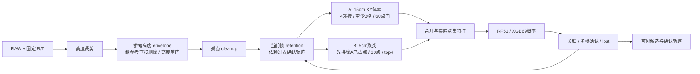

# 人体识别停滞根因分析与技术突破研究报告

**HUMAN-FUSION-DIAG R1 · 2026-10-11 · 只读审计、联网研究与隔离离线验证**

## 1. 核心裁定

项目没有证据支持“只要把 51D RF 换成更强分类器就能稳定识别人”。现有资料支持的是：**人体点被背景和候选门提前截断；训练输入与实际候选不一致；有效评测数据不足且负样本缺失；跟踪、保持和显示又把这些问题相互耦合。** 部分工程缺陷已经修好，XGBoost 在当前研究 Demo 的确减少了大量误检，但可靠人体识别、陌生目标泛化、双人 ID 和真实姿态/跌倒仍未闭合。

本轮新增了两项有判别力的实验，而非重复全部历史测试：

1. **S6 分层点支撑审计，476 ticks。** 第 187 帧人工人体原始点 260 个，234 个因参考高度网格缺失直接删除，最终留下 9 个；第 188 帧对应 268→245 个因缺参考删除→14 个留下。第 128/129/130/171 帧还受到点数、连通性门限制。它们在进入分类器之前已无可用人体候选。[新阶段证据](s6_stage_probe.json)、[脚本](s6_stage_probe.js)、[日志](s6_stage_probe.log)。
2. **只改变“缺参考点直接删除”的隔离 A/B，1,600 ticks。** 无条件保留这类点后，空场 S1 的确认轨迹 FP 从 0 增至 **740**；S6 候选 TP/FN 仍为 **65/6**，虽然救回三个旧失败帧，却新增三个失败帧。这个方案判为 **FAIL**，不得直接接入主链。[A/B 原始结果](missing_reference_ab.json)、[脚本](missing_reference_ab.js)、[日志](missing_reference_ab.log)。

**最有证据支持的下一步：冻结当前 XGB69 + UniqueTracker 研究基线，先建立可靠的候选/最终输出验收，再研究带可见性和语义约束的 UNKNOWN 背景旁路及稀疏候选。** 分类器保持为控制变量。不能把未知空间全部判成前景，也不能继续让未知空间无条件消失。

**结束检查的重要补充：** 并行开发新增了背景V3/骨架适配，整树冻结A01=BLOCKED；本轮输入及隔离引擎未变。第12节已核新源码与JSON，并新增固定候选推理验证：V3-B背景点保留改善有证据，但XGB在B家具候选上误判595/608；V3-PointNet评测遗漏中心化，错误制造heldout全中。最新结果进一步支持“先修输入与评测契约，再升级模型”。V2结果、V3背景对照与新增推理不能混成一套系统成绩。

### 五个最可能的根本原因，按证据和影响排序

| 排序 | 根因 | 证据强度 / 影响 | 能解释什么 | 已知边界 |
|---|---|---|---|---|
| 1 | **有效数据与评测单位不够，训练/验收长期错位** | 高 / 全系统 | 2,605 帧只有 814 帧当前有资格；候选 test/validation/stress 无有效负例；大量家具传播标签和同场景重复帧被误当作样本规模；模型成绩无法回答家具误检和泛化 | 当前按 session 划分不等于已经证明泄漏；早期 RF 的复制负样本跨 fold 则有明确源码证据 |
| 2 | **共享背景硬门与候选生成把可观测人体提前丢掉** | 高 / 遮挡、稀疏漏检直接瓶颈 | S6 f187/f188 的缺参考删除；f128–130/f171 点数/连通性失败；A/B 共用背景后的点，不是独立 RAW 语义通道 | 缺参考网格的物理来源尚 UNKNOWN；全部放行已实测失败 |
| 3 | **完整 GT ROI → 真实残缺/混合候选的分布差异，稀疏训练覆盖不足** | 高 / 分类误检漏检 | 完整 ROI RF 能“全对”，真实候选置信度下滑；训练已知正例最少 1,030 点，stress 最少 31 点；位置/点数代理与家具形状混淆 | 当前 XGB 有真实改善；不能据简化 PointNet 失败否定所有深度点云方法 |
| 4 | **确认、保持、关联、显示契约和版本不统一，使局部成绩替代最终效果** | 高 / 静止保持、ID、Demo 可信度 | 分类反馈决定 retention，改变后续候选；曾有同帧多候选共用 ID、union 点集不一致、旧服务版本/颜色问题；当前几何模式仍有内部 RF 票与显示不同步的语义限制 | 研究 Demo 中多项工程缺陷已修；主链未自动获得研究修复；双人身份质量 UNKNOWN |
| 5 | **视角/遮挡的物理信息上限与状态数据缺口** | 中高 / 严重遮挡、姿态、跌倒 | S6 部分 RAW 仅 19–36 点、高度带很窄；没有关节真值和有效真实跌倒验证；现有骨架多是 PCA/分带几何代理 | 无证据证明 IFW192S 整体不适合人体识别；多数已标人体 RAW 有数百至千余点；不能把软件删除都归咎硬件 |

对应证据分别见第 3–7 节及联网路线第 8–10 节。这里“高”指本仓库能直接复核的因果/结构证据，不代表已获得跨场景统计置信区间。

## 2. 调查范围、版本与证据资格

基线为 `master / 026e06303f60ed1bbe4ddc4d037836db68da6d27`。开始时对 **9,588 个 tracked + nonignored untracked 路径**建 SHA/大小/存在性基线；忽略文件中的关键会话/GT输入另做独立哈希，不宣称已保存全部ignored构建/缓存文件快照。树本来就有大量用户修改、未跟踪源码和待迁移文件。基线不是 clean-tree 声明。[基线](baseline_before.json)、[开始状态](git_status_before.txt)、[范围](00_SCOPE.md)、[唯一验收表 v1](ACCEPTANCE.md)。结束漂移见 [完整性复核](INTEGRITY.md)。

本轮只在新证据目录内编写诊断脚本、复制研究引擎和产生报告，并新增本工单回传。没有修改生产源码、当前 GT、参考背景、原始会话、模型、历史证据或旧回传；没有部署、采集、训练、提交、推送或启动其他开发者任务。读取了 HF/GL 与 HC/HR 当前入口，但历史授权没有被当作本轮实施授权。应用技能实际路径为 `C:/Users/30680/.codex/skills/ponytail/SKILL.md` 与 `C:/Users/30680/.codex/skills/scientific-toolkit-skill/references/scientific-skills/paper-lookup/SKILL.md`。

必须分清三个系统：

| 层次 | 当前实际实现 | 本报告可裁定范围 |
|---|---|---|
| 生产/PC 主链 | `pc_apps/human_core/engine.js`、replay/pipe；ROS HF 核心另在 `src/human_fall_detection/` | 源码审计；本轮未接入研究模型和 tracker |
| 研究实验室 | `sidequests/human_fusion_lab/`，复制引擎，候选 RF/XGB/PointNet 影子比较 | 历史 R5–R8 及本轮隔离副本；不等于板端部署结果 |
| 当前研究 Demo V2 | lab + `v2_runtime.js` + UniqueTracker；真实浏览器已有截图/逐帧记录 | 既有 18 条全会话离线输出重算；本轮额外新跑 S6 两模型和三会话反事实；没有新浏览器验收 |

例如 lab 引擎已写回 scoring union 的 `point_indices/count/bbox/scoring_centroid`，主链引擎相应位置仍没有同段修复；不能宣布整仓库一致。[lab 修复](D:/Code/ldiar/sidequests/human_fusion_lab/core/engine.js:446)、[主链消费者](D:/Code/ldiar/pc_apps/human_core/engine.js:380)。

本报告使用四种问题状态：**已解决**=在明确版本与验收范围内有证据；**部分解决**=修复一部分或只在研究/特定场景成立；**尚未解决**=可复现问题仍存在；**根因未知**=证据不足，标 UNKNOWN 并列补证要求。调查条目的 PASS 不等于人体识别系统 PASS。

## 3. 九会话与人工 GT 的真实规模

直接读取 `meta.json / points.bin / GT / manifest`，检查帧边界、28 字节点记录、SHA 绑定、有效点与 compact→raw 对应关系及成员越界；不是从 README 抄帧数。[数据审计](data_audit.json)、[逐人体 RAW 几何](person_geometry.json)、[审计代码](data_audit.py)。当前索引检查没有发现越界/compact 映射错误；这说明数据绑定与索引机制有效，**不能替代人体/家具语义的人工复核**。

### 3.1 覆盖率

| 会话 / sid 后缀 | 总帧 | 有资格标注帧 / 覆盖 | 主要标注与限制 | 实际时长 |
|---|---:|---:|---|---:|
| S1 空场 / 175227 | 304 | 304 / 100% | V3；家具 human 5、propagated 1,515；BACKGROUND human 1、propagated 303；实际只一帧人工标注 | 31.42 s |
| S3near / 175429 | 258 | 258 / 100% | PERSON human 258 | 26.64 s |
| S3far / 175553 | 464 | 99 / 21.34% | PERSON human 99；其余 365 帧 UNKNOWN | 48.00 s |
| S4 walk-stop / 175804 | 239 | 11 / 4.60% | PERSON human 11；其余 228 帧 UNKNOWN | 24.67 s |
| S5 turn / 175943 | 202 | 6 / 2.97% | PERSON human 6；其余 196 帧 UNKNOWN | 20.83 s |
| S6 occlusion / 180235 | 238 | 71 / 29.83% | PERSON human 71；其余 167 帧 UNKNOWN | 24.57 s |
| S7 nominal far5m / 180337 | 251 | 12 / 4.78% | PERSON human 12；其余 239 帧 UNKNOWN | 25.90 s |
| S8 long-still / 180557 | 523 | 53 / 10.13% | PERSON human 53；其余 470 帧 UNKNOWN；不能据此证明完整一分钟静止 | **54.12 s** |
| S9 two-person / 180751 | 126 | **0 有资格** | 当前文档含 18 标注帧 / 36 PERSON 对象，但 session SHA mismatch/missing；全部 126 帧评测 UNKNOWN | 12.95 s |
| 总计 | **2,605** | **814 / 31.25%** | 510 个有资格 PERSON 观察，均 source human；1,791 帧 UNKNOWN | 同一天、同室场景集 |

S9 并非“没有任何标签”，而是**已有标签目前不能与实际数据可靠绑定**。修复时不能只修改 SHA 使校验变绿，必须复核数据版本和实际点成员。`source:human` / `reviewed` 只提供来源资格，不能证明第二个独立审核者已验证所有区域。

### 3.2 候选训练集存在什么盲点

[真实候选数据审计](candidate_data_audit.json)：6,900 个候选中只有 **859（12.45%）**有已知标签，6,041 UNKNOWN。它是“生成出来的候选”样本，不包含未生成候选的漏检人体。

| 划分 | 会话 | 已知正例 | 已知负例 | UNKNOWN | 已知正例点数范围 / 特征 |
|---|---|---:|---:|---:|---|
| train | S1、S3near、S4、S5 | 142 | 566 | 1,772 | **1,030–1,785**；中位 1,179 |
| validation | S3far | 28 | **0** | 1,635 | 997–8,307；中位 6,036.5 |
| test | S7、S8 | 65 | **0** | 1,680 | 176–6,037；中位 1,117 |
| stress | S6 | 58 | **0** | 574 | **31–2,430**；中位 299.5 |
| blocked | S9 | 0 | 0 | 380 | SHA 不合格 |

GT purity ≥80% 的候选才能明确赋类，混合/未覆盖候选保持 UNKNOWN，这个处理方向正确；代价是大量实际困难负样本和边缘人体没有进入监督。于是“test 65/65，stress 58/58”主要说明**已生成且能明确映射到 GT 的正例被接受**，既不能证明家具区分能力，也不能计入上游没有候选的漏检。继续优化这些正例成绩，边际价值很小。

### 3.3 泄漏、相关性与场景记忆

**已证实的早期源码泄漏风险：** `train_person_rf.py` 先把空场去重后的特征 `uniq + uniq` 复制两份，再把后半分配给 far session 的 fold。留出 empty/far fold 时，同一精确负样本向量会同时出现在训练与测试。这是具体实现问题，不是泛泛猜测。[复制](D:/Code/ldiar/pc_apps/human_ml/train_person_rf.py:56)、[跨 fold 分配](D:/Code/ldiar/pc_apps/human_ml/train_person_rf.py:85)。该时期的 LOSO 不能证明负例泛化。单类训练 fold 应标不可评估或重新制定分组策略，不应靠复制测试负例补齐训练类别。

**当前模型未证实存在同类跨 fold 复制。** 当前 session 划分有分组，但同房间、同家具、同一天和相似人体仍造成场景相关性；S1 的传播标注不能成为独立家具实例；连续帧不能拿普通逐帧 Wilson 区间宣称大量独立样本。S6 已被多轮查看并比较模型，适合作为已暴露的回归集，不能再叫完全未见的最终测试。未标帧和低 purity 候选不得自动变成负例。

真正未证明的是：新人物、新家具、新朝向/距离、不同天和静止冷启动的泛化。需要独立身份/场景或至少不重叠连续片段、版本冻结后的盲评。现有九会话可以支持开发回归，不能自动承载最终外推结论。

## 4. RAW 是否足够：不能笼统说“雷达点太少”

本轮把有资格 PERSON 的 compact 成员映射回 RAW，并按已有 R/T 计算表面分布。高度使用 p95−p5，距离使用原传感器坐标的点距离中位数。它们是**人工选定的可见表面支撑**，不是完整人体尺寸，也不是校准后的关节真值。[逐观察数据](person_geometry.json)、[按会话汇总](data_audit.json)。

| 会话 | RAW 人体点数最小 / 中位 / 最大 | 高度 p90 中位 | 重要解释 |
|---|---|---:|---|
| S3near | 777 / 1,103.5 / 1,703 | 1.362 m | 可见人体表面并非普遍缺乏几何信息 |
| S3far | 781 / 6,387 / 6,904 | 见 JSON | 名称不等于所有标注帧都远；标注观察的传感器距离中位数范围约 0.78–2.93 m |
| S4 | 1,048 / 1,208 / 1,369 | 见 JSON | 标签稀疏，不能推断全程保持 |
| S5 | 1,080 / 1,618 / 1,715 | 见 JSON | 转身姿态变化覆盖仍少 |
| S6 | **19 / 277 / 2,145** | **0.949 m** | 8/71 个 RAW 观察少于 60 点；高度 p90 最小 0.241 m，存在严重部分可见 |
| S7 | 403 / 805.5 / 6,208 | 见 JSON | nominal5m 的标签实际距离并不全是 5 m，中位约 3.41 m，部分观察约 4.62 m |
| S8 | 1,059 / 1,076 / 1,097 | 1.472 m | 当前静止样本 RAW 很稳定；下游保持与误检更应关注 |

**裁定：RAW 在多数已标观察上足以支持人体检测研究；最严重遮挡帧有物理信息缺口。** 当前没有独立校准、视角改变对照或新硬件对照，无法给出硬件最终上限，标 UNKNOWN。点数高也可能集中在单一侧面，不能据千点推断手腕/膝关节可观测。

下一步应量化每个人体的可见高度带、有效空间体素数、与背景的距离、遮挡方向以及候选保留率；避免只拿全帧点数或会话名称解释失败。完全被遮挡的关节可由模型先验推断，不能冒充真实雷达测量。

## 5. 当前真实链路与失败归因

### 5.1 A/B 并没有绕开共同背景瓶颈

来源：[lab engine A 门](D:/Code/ldiar/sidequests/human_fusion_lab/core/engine.js:307)、[B 消费点集](D:/Code/ldiar/sidequests/human_fusion_lab/core/engine.js:380)、[pipe](D:/Code/ldiar/pc_apps/human_replay/human_pipe_lib.js)、[overlay](D:/Code/ldiar/pc_apps/human_replay/detect_overlay.js)。A 的 `cluster_features.ok` 在点数 <60 时提前失败；B 只看 `A.final_ids`，而且排除任意 A candidate 已占点，不能捞回背景删除或 A 已占的碎片。这里是两种粒度的候选生成，不是独立的 RAW 静态语义检测 + 动态前景检测。

retention 重新保留**当前帧**轨迹附近的点；分类票是时序平滑。两者都不是多帧点云几何积累。设置中的 180 s retention timeout 还受 `max_lost=30` 等生命周期限制，不能据常量宣称可稳定保持静止人体三分钟。

### 5.2 新 S6 证据：损失发生在哪里

所有计数来自冻结副本逐帧执行；分区守恒断言通过。表中“crop / 缺参考 / 高度差门”互斥；cleanup 在这些失败观察上没有继续删除人体点。帧号是 **0-based**。

| S6 frame | RAW GT点 | crop | 缺参考删除 | envelope 高度差删除 | BG后人体点 | 候选门 / 结果 |
|---|---:|---:|---:|---:|---:|---|
| 91 | 303 | 5 | 241 | 2 | 55 | RF retention 后 component 57点（55GT）<60；XGB 前期状态不同，retention 留回298GT、生成307点候选并确认 |
| 128 | 33 | 1 | 2 | 12 | 18 | A 不形成满足格数的 component，B无候选 |
| 129 | 22 | 0 | 0 | 13 | 9 | A component17点，<60；B无候选 |
| 130 | 19 | 0 | 0 | 9 | 10 | A component18点，<60；B无候选 |
| 171 | 36 | 0 | 8 | 4 | 24 | A component31点，<60；B无候选，细粒度连通性/点门未救回 |
| 187 | 260 | 8 | **234** | 9 | **9** | A/B均无人体候选 |
| 188 | 268 | 6 | **245** | 3 | **14** | A component16点，<60；B无候选 |

RF 无人体候选的帧为 `[91,128,129,130,171,187,188]`，XGB 为 `[128,129,130,171,187,188]`。**f91 说明更换模型通过确认反馈改变 retention，随后改变候选。** 因此 full-chain RF/XGB 比较能说明实际系统差异，却不是在相同候选上仅比较分类器的因果实验。分类能力应另用固定候选复算。

f187/188 的“缺参考”是当前 2.5D envelope 的网格 lookup 没有有效值；为什么这些网格无值，需要再对构图输入、可见性、坐标和量化策略追溯，目前 **UNKNOWN**。它不是“人体被在线学习成静态家具”的直接证据。当前 ref_only 禁止 online background，旧的全会话 occupancy 自吞静止问题与此次缺网格问题应区分。

### 5.3 新反事实为何失败

在冻结复制引擎的两个缺参考 `continue` 处，用 `bg=z-0.251` 使缺参考点通过现有 0.25 m 高度差门；其他分类器、阈值、tracker、输入和初始重置不变。没有改生产文件。baseline TP/FP/FN 与既有 Demo V2 对应记录逐一相等；三会话各跑原/改，共 1,600 ticks。

| 会话 | 原候选 TP/FP/FN | 全放行候选 TP/FP/FN | 原确认轨迹 TP/FP/FN | 全放行确认轨迹 TP/FP/FN |
|---|---|---|---|---|
| S1 空场 | 0 / 0 / 0 | **0 / 901 / 0** | 0 / 0 / 0 | **0 / 740 / 0** |
| S3near | 258 / 19 / 0 | **258 / 947 / 0** | 256 / 9 / 2 | **256 / 832 / 2** |
| S6 | 65 / 1 / 6 | **65 / 194 / 6** | 61 / 1 / 10 | **62 / 169 / 9** |

S6 f171/187/188 被恢复，但新 FN 为 f123/124/125，f128/129/130 仍失败。新增漏检的具体组件合并/关联机制尚未单独归因，不能仅凭结果编造原因。明确成立的是：**无条件保留缺参考点不是可接受修复；需要另一条有上下文语义、候选质量和空场误检约束的 UNKNOWN 分支。** FP 数是逐帧未匹配对象次数，不是 740 件不同家具或 740 次独立报警。

### 5.4 分类器成绩与最终输出的落差

历史完整 ROI 训练模型的反例非常清楚：R2 的 RFv2 把空场训练评估 FP 从 1,216 降到 0，test 正例 65/65；但真实 Fusion 的 near track 命中 **256/258→92/258**、far **96/99→12/99**、occlusion **61/71→42/71**。完整人体 ROI 分类变好，实际残缺候选反而被拒绝。[R2 完整记录](D:/Code/ldiar/docs/human_capture/evidence/2026-10-10_human_unify_fusion_r2/FINAL_REPORT.md)。

R4 直接比较 GT ROI 与实际候选：near 完整 ROI 的 v2 概率全部 1，而实际候选中位约 0.355；空场完整家具 ROI 全拒绝，实际前景碎片仍有高概率。[R4 点集/置信度审计](D:/Code/ldiar/docs/human_capture/evidence/2026-10-11_human_r4_candidate_audit_r1/FINDINGS.md)。分类输入不匹配已有直接证据。

当前 lab 的固定候选正例比较如下，不能读成完整系统准确率：[R5–R8 报告](D:/Code/ldiar/docs/human_capture/evidence/2026-10-11_human_fusion_r5_r8_lab_r1/REPORT.md)、[实际训练实现](D:/Code/ldiar/sidequests/human_fusion_lab/train.py)。

| 模型 | validation正例 /28 | test正例 /65 | stress正例 /58 | 解释 |
|---|---:|---:|---:|---|
| RF51旧基线 | 28 | 65 | 58 | 当前选入样本上已高召回，家具问题须看全链 |
| RF51候选重训 | 13 | 57 | 4 | 不能因“更贴近候选”而宣布成功；稀疏分布与样本量不足 |
| RF69候选重训 | 17 | 60 | 33 | 相对重训RF51改善，但仍差于旧基线召回 |
| XGB69候选 | 28 | 65 | 58 | 当前最适合保留的研究基线；独立负例泛化未证明 |
| 简化PointNet影子 | 28 | 58 | 39 | 不是完整官方 PointNet/PointNet++，且没有全链部署 |

51D 包含点数、位置、协方差/PCA、惯量、强度和高度带等特征；在同室同家具场景中容易学习位置/密度代理。[特征源码](D:/Code/ldiar/pc_apps/human_ml/frame_feature.py)。69D 增加六个相对高度带的点比例和 XY 分位宽度，保留为可解释形状特征；需要消融位置、绝对点数及强度尺度，不能仅扩维。

PointNet 影子是共享 ConvMLP + max pooling、256 点、有序索引采样、CPU 20 epochs，没有原版 T-Net。少点重复不能创造几何，大片段下采样也不代表细部均可见；目前证据只支持“这个小模型/训练配置不如当前 XGB”，不支持“深度学习无效”。CPU/ONNX 一致性也不代表 RKNN/NPU 可部署。

## 6. 当前 Demo、误检与跟踪到底改善多少

本轮读取 18 份既有 Demo V2 全帧 JSON 并重算汇总，**这是历史输出重算，不是本轮重新跑完九会话浏览器**。[重算文件](historical_v2_recalculation.json)、[既有 Demo 交付记录](D:/Code/ldiar/docs/human_capture/evidence/2026-10-11_human_fusion_demo_v2_r1/REPORT_FINAL.md)。当前所有表内模型都采用 V2 UniqueTracker，避免混用早期原 tracker 的数字。

匹配使用 XY 最近一对一、0.75 m 距离门；候选 ≥0.35，strong vote ≥0.55，确认需 5 帧窗口 3 票和 min_age。**距离匹配 TP 不证明分割纯度/完整人体 bbox 正确。** UNKNOWN 帧不进入 TP/FP/FN；S1 空场协议可支持有资格帧上的空场误检，但其他会话的 unmatched FP 不等于全部有明确家具身份。

### 6.1 最终确认轨迹，逐已标观察计数

| 会话 | RF51 TP / FP / FN | XGB69 TP / FP / FN | 裁定 |
|---|---|---|---|
| S1 | 0 / 600 / 0 | **0 / 0 / 0** | 当前研究 Demo 空场误检有明显真实改善；S1参与训练，非独立家具测试 |
| S3near | 256 / 372 / 2 | **256 / 9 / 2** | 人体召回保留，误检大降 |
| S3far | 97 / 211 / 2 | **97 / 93 / 2** | 仍有严重 FP；该切片 precision 97/(97+93)=**51.05%** |
| S4 | 10 / 22 / 1 | 10 / 8 / 1 | 少量标帧改善；连续走停保持 UNKNOWN |
| S5 | 5 / 5 / 1 | 5 / 0 / 1 | 标注太少，不作全程转身结论 |
| S6 | 60 / 137 / 11 | **61 / 1 / 10** | FP大降，但已知人体仍漏10/71；candidate漏6/71 |
| S7 | 11 / 18 / 1 | 11 / 1 / 1 | 稀少标帧结果，不证明5m全程能力 |
| S8 | 51 / 51 / 2 | 51 / 0 / 2 | 当前静止切片有改善；不能覆盖未标470帧 |
| S9 | UNKNOWN | UNKNOWN | SHA 不合格，双人识别/交叉无可靠裁定 |

在当前 510 个有资格 PERSON 观察和相应已标场景上的回顾性汇总：RF 候选 `503/1469/7`，XGB `504/127/6`；RF 确认轨迹 `490/1416/20`，XGB `491/112/19`。XGB 候选 precision/recall **79.87%/98.82%**，轨迹 **81.43%/96.27%**。这是混合开发/训练/测试/压力场景汇总，不是独立测试成绩。低标注覆盖、单人协议和0.75m门均限制外推。

### 6.2 截图与代码相互印证，未用漂亮画面替代指标

已经直接查看真实既有截图：[空场 RF 家具高分误检](D:/Code/ldiar/docs/human_capture/evidence/2026-10-11_human_fusion_demo_v2_r1/FURNITURE_RF51_F20_03.png) 与 [S6 f128 可见漏检](D:/Code/ldiar/docs/human_capture/evidence/2026-10-11_human_fusion_demo_v2_r1/PERSON_MISS_F128_03.png)。前者同候选 RF 高分、XGB 低分，支持分类改善；后者 GT 圈内无 accepted person，和本轮稀疏候选失败一致。截图不足以独立给出 BG 删除计数，那部分结论来自新阶段 probe。

原 FusionTracker 对多个 candidate 顺序 nearest-match，没有同帧 claimed 保护，可能把多个对象绑定同一个 ID并重复投票。[旧 tracker](D:/Code/ldiar/sidequests/human_fusion_lab/core/fusion.js)。UniqueTracker 使用排序边的 greedy 一对一、每帧单次更新/投票，V2 begin 和 segment reset 都重新装入；同帧重复 ID 的工程缺陷在研究范围已有修复。[当前 UniqueTracker](D:/Code/ldiar/sidequests/human_fusion_lab/unique_tracker.js)、[实际 V2 runtime](D:/Code/ldiar/sidequests/human_fusion_lab/v2_runtime.js)。

但它仍没有运动模型、速度补偿或全局 Hungarian 关联，也没有有效 S9 ID 真值。多个 fragment、交叉、短遮挡后的重认、人体离开后的家具继承 ID 仍不能据“没有重复 ID”宣布解决。跟踪可以保留预测，不能把预测到的人体当作当前帧真实检测。

Q01 曾修复几何模式后处理与可见 track 标志、CDP 第一帧等待错误、旧本地服务/颜色缓存等；这些属于工程一致性改善。几何评分后处理仍在 engine 的 RF tracker 更新之后，显示关闭不等于内部状态变成几何 tracker。[Q01 条件裁定](D:/Code/ldiar/docs/human_capture/evidence/2026-10-11_q01_review_r1/Q01_FINAL_ACCEPTANCE.md)、[修复报告](D:/Code/ldiar/docs/human_capture/evidence/2026-10-11_q01_review_r1/Q01_FIX_REPORT.md)、[实际 detector](D:/Code/ldiar/sidequests/human_fusion_lab/detector.js)。当前只能叫研究工具条件接受，不能叫生产人体识别验收通过。

## 7. 历史复盘：真实改善、失败与未闭合项

以下按原轮次记录结果，不覆盖原有 PASS/FAIL，也不把后来发现的缺陷回填为过去已经解决。历史测试 totals 只证明当时运行范围。

| 历史问题 / 措施 | 真实结果与证据 | 当前问题状态 / 未解决部分 |
|---|---|---|
| 早期 limb 密度定位、PCA、z带、4s背景、hint 等多版 | 研发记录记载锁沙发/柜子、静止后吞人、伪弯腰；实际代码按 PCA/高度和极值生成肢体，不是学习到的关节。[研发记录](D:/Code/ldiar/pc_apps/human_limb/README.md)、[实际17点生成](D:/Code/ldiar/pc_apps/human_limb/limb_lib.py:483)、[6点几何猜测](D:/Code/ldiar/pc_apps/human_limb/limb_v2.py:150) | **尚未解决**人体语义/真关节。历史六版结果属当时记录，本轮未重演；人体骨架线不能证明找到了人 |
| W03R2 静态占据、天花板/地面裁剪 | 旧165帧 clusters 1231→599、foreground 6413→3017，减少杂点；当时就记录 ≥85%占据会吸收静止人体。[R2实测记录](D:/Code/ldiar/docs/human_capture/evidence/2026-10-06_hrw03_r1/README.md)、[构图实现](D:/Code/ldiar/pc_apps/human_replay/human_pipe_lib.js) | **部分解决**背景/裁剪；点和绿框减少不等于人体 FP 改善；使用整会话构图存在未来信息和静止污染 |
| W03R3 重新裁定 occupancy 分母、hit≥2稀疏静物、voxel中心距离 | 最终用户裁定停止盲调旧阈值，转向 WD01 家具真值。[原裁定](D:/Code/ldiar/docs/human_capture/evidence/2026-10-06_hrw03_r3/11_user_verdict.md) | **已解决（诊断层）**：不能再称纯阈值小问题；语义识别本身未通过 |
| reference R3.1 / ICP R3.2 / AABB R3.3 | 指定 WD01 匹配 .854→.991；后续 AABB .994→1；指定人体保留≥97.7%，说明坐标/查询度量确有改善。[r4目录](D:/Code/ldiar/docs/human_capture/evidence/2026-10-06_hrw03_r4/)、[r5目录](D:/Code/ldiar/docs/human_capture/evidence/2026-10-06_hrw03_r5/) | **部分解决**：只在该参考与标注集；不能移植成当前九会话的可靠识别结论 |
| E1 把 NO_REF 归为参考缺覆盖，后被纠正 | 旧 r8 猜测参考不足；r9 追踪 1,035 NO_REF 点，查询 cell 实际均观测，Focc102帧100%；1,010/1,035（97.6%）是量化 centroid 距离落在5–12cm而查询门5cm。[旧归因](D:/Code/ldiar/docs/human_capture/evidence/2026-10-06_hrw03_r8_e1/08_final_attribution.md)、[**后续有效纠正**](D:/Code/ldiar/docs/human_capture/evidence/2026-10-06_hrw03_r9_ref_coverage/09_final_attribution.md) | **已解决（该轮根因定位）**：该数据不能继续叫“物理没扫描到”。当前 S6 是另一套2.5D envelope缺键，需要独立追溯，不能混为同一原因 |
| W03R39 closeout | 正式 REWORK_REQUIRED：gate5938/11959=49.652981%未达50%；31被删点语义UNKNOWN，非WD01的155行UNKNOWN；loader在统计修正后STALE。[最终记录](D:/Code/ldiar/docs/human_capture/evidence/2026-10-07_hrw03_r39_closeout/08_final_closeout.md) | **尚未解决 / UNKNOWN**。不能因绿框132→67宣布误检下降或工单通过 |
| Fusion V2 reference优先、禁止在线污染、retention | 指定11例保留及高点保留率改善，是保留几何的证据。[原对照](D:/Code/ldiar/docs/human_capture/evidence/2026-10-08_fusion_v2_ab_r1/README.md) | **部分解决**：避免特定自吞/提供当前点保持，不是陌生静止人体冷启动识别，也非真多帧积累 |
| B2A claimed / min_age / session generation /颜色版本 | 重复处理、年龄和版本问题有针对修复；后续复审发现 stale Python shadow probe 可重现旧错误，需看实际消费入口。[修复与复验](D:/Code/ldiar/docs/human_capture/evidence/2026-10-09_b2a_fix_r1/FIX_R1_REPORT.md) | **已解决（对应版本工程缺陷）**；不能据此宣布ID交叉稳定或分类有效 |
| C1 动态稳定化、RF门、n≥500 | 原6会话915帧主要站立/AI自动标签，没有动态人工真值；柜子 RF可>.76，500点门压柜同时威胁稀疏人体。[原结果/限定](D:/Code/ldiar/docs/human_capture/evidence/2026-10-09_c1_dynamic_stabilization/FINAL_REPORT.md)、[原RF训练](D:/Code/ldiar/pc_apps/human_ml/train_person_rf.py) | **部分解决**特定空场干扰；动态和负例泛化UNKNOWN；旧逐帧高准确率需降级 |
| 聚类 spike：DBSCAN/adaptive等 | 12条1.2–3m站立数据2874帧，几路人体anchor结果未见差异；额外细分和CPU代价，柜子有增有减。[原失败/UNKNOWN记录](D:/Code/ldiar/docs/human_capture/evidence/2026-10-10_spike_cluster_r1/FINAL_REPORT.md) | **尚未证明有益**；不能据这组稠密站立数据断言S6稀疏候选也无需改 |
| RF扩维 / HistGBDT69 / 去位置代理 | 旧六静态弱标集1239候选，RF51/69弱标签FP128/FN1，HistGBDT69 FP12/FN1，去位置代理FP34；有模型/导出工程成果。[原closeout](D:/Code/ldiar/docs/human_capture/evidence/2026-10-10_rf_optimization_r1/21_CLOSEOUT.md) | **部分解决**弱标签下区分；人工真值和独立最终链路仍BLOCKED；不能和当前XGB全链混成一套数字 |
| RFv2/v3完整ROI重训 | ROI得分改善，实际Fusion召回大跌；桶采样未补齐真实残片域。[R2](D:/Code/ldiar/docs/human_capture/evidence/2026-10-10_human_unify_fusion_r2/FINAL_REPORT.md)、[R4](D:/Code/ldiar/docs/human_capture/evidence/2026-10-11_human_r4_candidate_audit_r1/FINDINGS.md) | **已证实失败方向**：不能只以ROI分类指标验收 |
| R4→R5 A+B union、公有indices、Float32阈值 | 研究副本补齐43次union的实际点集；九会话2605帧点索引/特征、6模型native导出一致性有日志。[R5–R8](D:/Code/ldiar/docs/human_capture/evidence/2026-10-11_human_fusion_r5_r8_lab_r1/REPORT.md)、[实际lab修复](D:/Code/ldiar/sidequests/human_fusion_lab/core/engine.js:446) | **已解决（研究副本）**输入契约；主链同步仍是独立事项，不能默认已完成 |
| XGB69 / PointNet / rawstatic dual path | XGB保留当前正例、全链FP明显下降；PointNet影子较差；dual path初测遮挡68/71但空场candidateFP624、trackFP605，重训后遮挡4/71，未通过。[lab报告](D:/Code/ldiar/sidequests/human_fusion_lab/REPORT.md) | XGB **部分解决**；简化PointNet/当轮dual path **尚未成功**。不是证明独立RAW语义路线理论无效 |
| Q01 + DemoV2 UniqueTracker / CDP / shape | 研究软件和浏览器既有证据可用，原同帧多候选共享ID已修；shape明确proxy/UNKNOWN。[Q01](D:/Code/ldiar/docs/human_capture/evidence/2026-10-11_q01_review_r1/Q01_FINAL_ACCEPTANCE.md)、[V2](D:/Code/ldiar/docs/human_capture/evidence/2026-10-11_human_fusion_demo_v2_r1/REPORT_FINAL.md) | **部分解决**：工具能展示/对比失败，识别生产验收、双人、真实姿态仍BLOCKED |
| 本轮S6阶段定位 / 缺参考全部保留 | 直接定位前分类损失；反事实全放行严重FP且无净候选召回增益。[新probe](s6_stage_probe.json)、[新A/B](missing_reference_ab.json) | 定位 **已解决**；修复 **尚未解决**；全放行方案FAIL |

为什么一直没有彻底解决：早期修的是“杂点/绿框/颜色/轨迹数量”，后期修的是“被选中的完整ROI或明确正候选”；两类工作都没有持续约束 **RAW真实人体→候选覆盖→语义接受→同一身份→最终可见输出**。困难负例、未生成候选的漏检、未标帧和双人资格缺口使实验不能对主要失败施加完整压力。新的模型又会反馈改变 retention，导致“一个阈值修好另一场景却坏掉”。这解释长期反复，但不是否定所有已完成工程成果。

### 7.1 骨架、姿态、跌倒实际到了哪层

| 子系统 | 源码实际行为 | 裁定与缺的数据 |
|---|---|---|
| human_limb 17/6点 | PCA主轴、固定偏移、分带极值；elbow/knee按中点插值 | **几何猜测**，没有关节监督训练/真实关节精度验证。家具也能画出骨架 |
| HR-SKELETON-OFFLINE | HEAD/UPPER_TORSO/CHEST/PELVIS/LOWER等区域中位点、支持量/可见性，UNKNOWN保护 | **区域代理研究工具**；336候选未人工review，120分支行来自100 unique frames，GT仍BLOCKED；synthetic/binding通过不能替代关节真值。[实际脚本](D:/Code/ldiar/docs/human_capture/evidence/2026-10-09_hrskeleton_offline_r1/skeleton.py)、[回传](D:/Code/ldiar/docs/human_capture/returns/HR-SKELETON-OFFLINE.md) |
| DemoV2 shape | upper/middle/lower 三带 surface centers，标 GEOMETRIC_PROXY_ONLY、UNCALIBRATED、poseUNKNOWN | **部分解决**显示诚实性，没有实现可靠全身姿态。[runtime](D:/Code/ldiar/sidequests/human_fusion_lab/v2_runtime.js) |
| Fusion fall hook | tracker创建pose_history=[]；引擎仅history≥10才调用fall_assess，当前tracker没有真实填充相应历史 | **尚未闭合**；存在调用点不等于运行中有有效跌倒事件。[tracker](D:/Code/ldiar/sidequests/human_fusion_lab/core/fusion.js:54)、[调用门](D:/Code/ldiar/sidequests/human_fusion_lab/core/engine.js:526) |
| ROS HF06 fall_state | 同一identity基线、下降、低位持续等7状态；mode_verified=False/allow_confirmed=False默认关闭confirmed | **有真实状态机实现，物理验证未获本轮证据**。[实际状态机](D:/Code/ldiar/src/human_fall_detection/core/fall_state.py) |

跌倒研究不必等待完美17关节：可靠人体分割/ID后，可先用地面相对高度、垂直速度、低位持续与不确定性做粗事件。需要实际跌倒与坐/蹲/躺/遮挡等ADL对照、身份连续性和地面标定；当前九会话不能支持跌倒可靠性或关节误差指标。没有这些数据，换 SMPL 模型也不能自动完成跌倒验收。

## 8. 联网调研：哪些方案能借鉴，哪些不能直接迁移

调研日期 2026-10-11。检索 GitHub、arXiv、CVF、出版商/作者页面，并用 GitHub API 获取真实 tree/HEAD、下载选定源码/配置，Crossref核 DOI。没有执行外部代码、下载大数据集或训练论文模型。以下“可复现资产”指作者提供代码/数据入口，不是本项目已经复现。[源码/许可/commit清单](research/manifest.json)、[补充核验](research/supplement_manifest.json)。

### 8.1 固定式室内检测与静止目标

**R01 — hdl_people_tracking，ROS工程参照。** [作者代码](https://github.com/koide3/hdl_people_tracking)、[论文](https://doi.org/10.1177/1729881419841532)。背景分离、split/merge候选、Kidono213D+Boost、跟踪，提供静态传感器launch。优点是完整模块与真实ROS入口，可借鉴候选/观测/轨迹分离；局限是旧PCL/OpenCV、原权重域不同，背景初始化对静止冷启动没有自动保证。本轮读到 classifier 在模型无效时 `return true`，移植必须 fail-closed/UNKNOWN，不能把报错当人体通过。[冻结分类源码](research/koide3__hdl_people_tracking/src/kidono_human_classifier.cpp)。兼容本项目XYZI和固定传感器，但不能把依赖库直接加入现有board Python链；先离线借结构，重训本域候选。

**R02 — O-LiPeDeT，直接相关的固定室内3D检测研究（2026预印本）。** [论文全文](https://arxiv.org/html/2603.04938v1)、[真实代码/配置与数据入口](https://github.com/nilushacj/O-LiPeDeT-Overhead-LiDAR-Person-Detection-and-Tracking)。2.94m顶置LiDAR，微调SECOND/VoxelNeXt/PointPillars等，之后KF关联。29训练帧、1验证帧、76测试帧，测试含10位新参与者；BEV IoU≥0.10，≤5m SECOND AP=.837、PointPillars AP=.451/recall=.433。作者报告预训练PointPillars/PV-RCNN未经微调零TP，直接支持“视角域差要处理”。跟踪ID为自动生成pseudo-GT，不能抄其身份指标当严格基准。适合借本域box标注、RAW检测和域微调；我们的低位斜视不等同顶视，静止持续实验仍需自做。训练代码使用CUDA、配置XYZI；CPU/NPU兼容尚UNKNOWN。

**R03 — Efficient Detection and Tracking of Human Using 3D LiDAR Sensor，Sensors2023。** [原论文/摘要](https://pubmed.ncbi.nlm.nih.gov/37430633/)、[出版商](https://www.mdpi.com/1424-8220/23/10/4720)、[实际实现](https://github.com/baberjunaid/LiDAR_Tracking_3D)。超体素/局部几何分类、运动检测初始化ROI、预测减少处理量，在真实室内Ouster录制验证。可借局部几何、部分可见身体和预测ROI；**运动初始化不能证明从第一帧一直静止的人可被发现**。单传感器无需穿戴IMU，但线束/视场/反射分布与IFW192S不同；ROS/PCL代码先离线适配，不搬权重和算力声明。下载源码的GitHub许可字段未声明，复用许可需另核。

**R04 — Moving objects extraction for building environmental maps describing human walking activity using a 3D LiDAR，Advanced Robotics2022。** [出版商原文](https://www.tandfonline.com/doi/full/10.1080/01691864.2022.2126732)、[Crossref核验](research/crossref_10.1080_01691864.2022.2126732.json)。第2节用cluster角度变化标准差及背景差分代价，区分静止人和墙/架；会议室用120s初始化、120.1s人工点标比较，报告七个坐着的人保留，也有遮挡不足导致的非人体FP。对静止冷启动比单纯运动ROI更相关，可借表面粗糙度/局部背景更新特征；120s等待不符合当前短会话，门限也需本域重定。网页直接访问曾受限，后来出版商索引返回第2节正文；未找到可核源码/可下载完整数据，**复现级别低于有代码方案**，不把特定实验推广成本项目已解决静止识别。

**R05 — OctoMap，可见性/UNKNOWN成熟工程语义。** [官方说明](https://octomap.github.io/octomap/doc/index.html)、[代码](https://github.com/OctoMap/octomap)。概率占据明确区分occupied/free/unknown并使用射线插入/查询。它不是人体检测器；最有价值的是参考缺失不能自动等价背景/前景。固定安装无需IMU，已有XYZ即可先做轻量可见性格表，结合已有参考覆盖诊断；不要求立即引入整套octree。需要传感器原点/坐标和参考版本可信，移动家具不能永久冻结成真值。

### 8.2 稀疏、时间融合、学习表示

**R06 — UMOSMOTS，WACV2023固定传感器4D运动分割。** [作者代码与论文入口](https://github.com/thkreutz/umosmots)、[原论文页面](https://openaccess.thecvf.com/content/WACV2023/html/Kreutz_Unsupervised_4D_LiDAR_Moving_Object_Segmentation_in_Stationary_Settings_With_WACV_2023_paper.html)。利用多变量占据时间序列与空间组织，无监督分离运动目标；本轮读了数据转换/时间窗口代码。能借因果occupancy序列、跨帧支持量和背景置信度，**固定场景≠检测静止人体**，输出是运动而非人语义。适合辅助动态分支；长期零运动人体仍需RAW语义分支。许可API未声明，迁移前另核，不把它作为现成静止人体答案。

**R07 — PointNet / PointNet++。** [PointNet论文](https://arxiv.org/abs/1612.00593)、[原版代码](https://github.com/charlesq34/pointnet)、[PointNet++论文](https://arxiv.org/abs/1706.02413)、[MSG实际源码](https://github.com/charlesq34/pointnet2)。PointNet全局集合编码；PointNet++增加局部层级、多尺度邻域适应采样密度。可用候选或点级标签学习残片几何，且不要求目标运动；但ModelNet对象分类不是拥挤室内检测，需本域真实残片与家具负例。少于几十点无法凭采样补回遮挡；旧TF/CUDA算子与board stdlib+NumPy约束不兼容。先在隔离PC尝试小型多尺度上下文模型，保持相同候选和训练预算；不重复当前tiny-PointNet的结论外推。

**R08 — PointPillars / SECOND / VoxelNeXt，RAW或BEV直接检测。** [PointPillars原论文](https://openaccess.thecvf.com/content_CVPR_2019/html/Lang_PointPillars_Fast_Encoders_for_Object_Detection_From_Point_Clouds_CVPR_2019_paper.html)、[OpenPCDet](https://github.com/open-mmlab/OpenPCDet)、[固定室内适配实例](https://github.com/nilushacj/O-LiPeDeT-Overhead-LiDAR-Person-Detection-and-Tracking)。pillars/voxel→空间特征→box，让候选生成本身学习，能绕开当前连通硬门；几何检测**并非只能识别移动行人**。主要限制是汽车数据的视角/强度/密度和anchors域差，需本域box监督、背景困难负例、GPU训练；不能照搬权重。PointPillars二维骨干可能较利于后续部署，稀疏3D卷积的NPU支持需独立验证。优先小BEV多高度层原型，而非直接上最大网络。

**R09 — RandLA-Net，点级语义参照。** [论文](https://arxiv.org/abs/1911.11236)、[作者代码](https://github.com/QingyongHu/RandLA-Net)。局部特征聚合与随机采样，用真实点语义标签处理大规模点云；能从RAW给人/家具/背景语义，减少候选先被丢弃的依赖。需更密集本域点GT；室内建筑语义标签并不自动提供遮挡人体实例/ID。旧框架/算子和许可条件须核，不是当前少量候选数据即可可靠训练的方案。借点级semantic辅助和候选上下文监督，排在数据闭合之后。

**R10 — XGBoost，低成本主基线。** [原论文](https://arxiv.org/abs/1603.02754)、[官方实现](https://github.com/dmlc/xgboost)。树提升适合当前可解释相对形状/背景覆盖/时序统计的表格特征，静止与运动都可分类；本项目已具native JS导出与Float32一致性证据。限制是特征和候选信息上限、少量同域负样本与不可靠概率校准，不能恢复被删点或未生成候选。首要借法是固定actual candidates、困难负例、去位置/点数代理消融以及最终FP约束，RF保留作控制基线。

### 8.3 跟踪与国内人体姿态研究

**R11 — SimpleTrack / AB3DMOT。** [SimpleTrack论文](https://arxiv.org/abs/2111.09621)、[源码](https://github.com/tusen-ai/SimpleTrack)、[AB3DMOT源码](https://github.com/xinshuoweng/AB3DMOT)。KF预测、Hungarian/几何关联和轨迹生灭；本轮读 SimpleTrack `association.py`，不是只读介绍。无需学习和IMU，能借时间单位一致、速度门、每帧一对一和预测状态隔离。依赖可信box/检测且为车载基准设计，无法把柜子变成负例，也不能证明交叉遮挡零换ID。先做轻量二维CV模型+全局关联shadow，并用人工ID评测，保留当前Unique作对照。

**R12 — LiveHPS，上海科技大学CVPR2024，国内有真实作者代码的单LiDAR姿态路线。** [原论文全文](https://arxiv.org/html/2402.17171v1)、[作者代码/数据入口](https://github.com/4DVLab/LiveHPS)。用蒸馏、连续帧姿态优化和SMPL估计处理点分布变化/遮挡。推理单LiDAR不要求穿戴IMU；训练FreeMotion使用多模态标定真值。优点是明确研究稀疏/噪声/部分可见身体，局限是需人体点输入、时序和高质量姿态监督；默认CUDA、SMPL资产与代码许可分别核，IFW192S域和RKNN支持未证实。可在检测/ID稳定后借时序特征和不确定关节输出，当前不宜拿它补救家具识别。

**R13 — LiDARCap / LIP 的适用边界。** [LiDARCap原论文](https://arxiv.org/abs/2203.14698)是LiDAR人体动作监督路线，可以作为真实姿态数据/时序先验来源；本轮未确认可用的对应作者代码仓库，复现状态UNKNOWN，不提供猜测链接。[LIP作者代码](https://github.com/4DVLab/LIP)明确融合稀疏穿戴惯性和LiDAR，**不能直接满足无穿戴IMU条件**。借数据标定/遮挡不确定性方法可以，改换传感器条件不属于本轮方案。

外部方法的共同启示是：语义检测、运动分割、时序保持、姿态回归是不同任务；任何一项论文高分都不能跨任务代替本项目证据。真正符合固定安装的RAW几何检测不需要目标运动；依赖运动初始化/差分的模块应辅助它。外部可复现资产与硬件条件对照清单见 [研究阅读记录](RESEARCH_NOTES.md)。

## 9. 技术取舍与三条可执行路线

### 9.1 保留、优化、替换与淘汰

| 决策 | 对象 | 原因与具体动作 |
|---|---|---|
| 保留 | RAW存储、版本化GT、SHA/compact→raw校验 | 当前成员映射可核；增强数据资格，不重采样/覆盖原会话 |
| 保留为研究基线 | XGB69、RF51对照、UniqueTracker、可诊断Demo | XGB全链FP有实证下降；Unique修同帧多用ID；固定原版便于反事实 |
| 优化 | 三态背景/参考可见性、相对高度/宽度、候选质量 | 将缺参考明示UNKNOWN；并行语义审查，不能直接删除或全放行；加形状/背景覆盖/邻域上下文 |
| 优化 | 稀疏候选、因果短窗融合、硬负样本训练 | 先记录每个拒绝门，再用距离/可见性自适应候选；时序只用过去，不将同一点重复当额外观测 |
| 优化/替换 | greedy无运动关联 → 运动预测与全局一对一shadow | 先建立有效ID真值；prediction/coast与measured明确区分，避免家具继承 |
| 逐步替换（有数据后） | BG后连通候选独占入口 → RAW上下文语义/BEV proposals | 解决静止冷启动和背景硬删除；原FG用于动态优先与加速，不拥有全部检测权 |
| 淘汰为验收依据 | 完整GT ROI准确率、只有正例的test“accuracy”、绿框/点数减少、逐帧独立CI | 不能评估终端误检漏检、上游召回或泛化；保留历史记录，停止据此宣布系统通过 |
| 淘汰当前具体方案 | 复制负例跨fold、任意n≥500封门、缺参考全部放行、AI标签自动当真值 | 已有具体反例/实现证据；改成有效标签、UNKNOWN、预注册全链约束 |
| 降级显示 | PCA骨架/3带shape | 明确proxy、可见性和UNKNOWN；不可当pose/fall ground truth |

### 9.2 路线比较

成本是单名熟悉项目工程师的粗估，含离线实现/整理，不含等待人工标注、采集或板端迁移；不是已承诺工期。

| 路线 / 优先级 | 核心实施 | 预期解决问题 | 数据与成本 | 主要风险 | 验证/升级条件 |
|---|---|---|---|---|---|
| **A 低风险渐进，优先** | 固定XGB69；候选点损失账本；参考三态+受约束UNKNOWN局部分支；稀疏候选/0.2–0.5s因果支持；实际候选困难负例；最终轨迹指标 | 已定位S6前分类漏检、静止保持、家具误检控制与评测可信度 | 先用现有九会话；新增人工review为新版本候选/连续帧；约5–10工程日；无需新深度框架 | 放行UNKNOWN导致FP/合并、低点噪声、现有标签过稀；全放行已FAIL | 第10节E1–E5；先软件离线，泛化和物理结论继续BLOCKED |
| **B 中等重构，第二优先** | 独立RAW语义通道：地面坐标、多高度BEV/局部体素+上下文；小2D卷积检测或本域PointPillars/SECOND适配；与动态FG融合；统一score/track/UI入口 | 从入口避免静止冷启动遗漏、碎片/家具粘连；候选生成学习化 | 现有可见人体GT可派生初始box，但需人工确认box/负例/遮挡；同域预训+本域微调；约2–4周，GPU训练 | 极小训练集过拟合；斜视域差；BEV二维重叠；CUDA/sparseops部署障碍 | 与路线A同一冻结片段逐层/最终指标；只有上游召回+最终FP同时改善才升级；不可因训练loss低接入 |
| **C 研究型4D算法，后置** | 可见性与背景状态驱动的局部时空编码、运动补偿、多尺度点特征；密集teacher→稀疏student/部分可见增强；显式未知输出；未来接时序pose | 稀疏/遮挡连续观察、跨距离密度变化；长期稳定/可置信姿态 | 需更连续点/ID/姿态真值及场景/人物覆盖；先现有数据做可行性，约6–12周+标注；GPU | 误匹配累积家具/不同人、伪完整身体、对当前同域记忆；无保证补回完全遮挡 | 必须做时间方向、移除历史、ID错误注入和密度/姿态分层消融；无真实姿态GT只裁定检测/表面，pose保持UNKNOWN |

路线A也要拥有“从第一帧静止”的语义发现能力：不能只保护先前被确认的人。路线B/C是候选和表示升级，不是单纯加深分类器。现阶段不建议启动真实17关节、RKNN适配或再做漂亮Demo作为主突破项；这些工作不能消除已定位的入口缺失与数据盲区。

## 10. 下一阶段最值得先做的五个离线实验

下面是**建议的新验收契约，尚未执行/尚未授权生产接入**。先写新版本acceptance，再动隔离副本；同一轮最多改变一个归因层。所有阈值是拟定工程目标，不是已获得成绩。完整任务书见 [CLAUDE_TASKBOOK.md](CLAUDE_TASKBOOK.md)。

共同计分规则：UNKNOWN不入负例；0.75m中心匹配与更严格的point purity/box IoU结果并列；逐帧candidate、实测confirmed、coasting预测分开；记录FP帧率/持续事件、FN段长/恢复时延、重复ID/IDSW/IDF1、p95/内存。使用过的S6作为开发回归；新/未暴露盲评片段冻结后不得反复据其调参。统计按独立session/人物或片段报告，当前数据不足时不编置信区间。

| 优先级 / 实验 | 隔离设计 | PASS 判据 | FAIL / BLOCKED 判据 |
|---|---|---|---|
| **E1 数据资格与真实候选负例闭合** | 审查S6六个无候选帧及邻帧、S4走停/S8静止连续窗；S1 propagated在首/中/末及变化点做人工抽核；S9按实际点重新核绑定和身份；冻结真实candidate点集、UNKNOWN原因、split。先程序候选清单，人工review另存新GT版本 | 每个拟评分观察有有效SHA/索引/明确审核；所有漏检对象能追到RAW→每个门；新val/test均含独立于train的已审核非人体候选；跨fold精确复制0；split与人工审核来源可追溯 | 元数据检查PASS不等于语义PASS；人工未审、S9身份/绑定不明、仍无有效负例→BLOCKED。现有同一套家具不足以证明新家具泛化，保持UNKNOWN |
| **E2 三态参考与受约束UNKNOWN语义旁路** | 冻结XGB/Unique，保留有效参考分支；单独输出unknown-support候选，不立即污染静态参考/confirmed；组合局部几何/覆盖率、上下文与时间支持；对照本轮全部放行FAIL | S6 candidate TP≥67/71（基线65），confirmed TP≥64/71（基线61）；f187/188候选各覆盖≥50%可见GT且purity≥80%；S1 confirmed FP=0；S3near confirmed TP≥256/258、FP≤9 | 任一已知场景终端FP/召回约束破坏即FAIL；有效负例缺失不能宣称泛化PASS；f187/188救回却把其他帧丢掉需记录，不能只截成功帧 |
| **E3 稀疏候选与因果多帧支持** | 在E2稳定副本后独立做 n门/连接拓扑消融；过去0.2/0.5s窗口，保留时间标签，候选运动补偿；不借未来、不把重复坐标计新几何。固定分类器另跑同候选评分 | f128/129/130/171至少2帧生成正确候选（purity≥80%、可见GT覆盖≥50%）；S6 candidate FN≤4/71；S1 confirmed FP=0，near confirmed TP≥256/258；PC计算p95≤50ms（不含渲染，单独报） | 低点放行只造噪声/家具、轨迹漂移混入静物、非因果未来帧“救回”、合成点冒充实测→FAIL；没有可观测支持时UNKNOWN |
| **E4 固定候选的形状/上下文分类消融** | E1人工困难负例后固定点集/split/预算；RF51、去位置/密度代理、相对高度/背景状态特征XGB69+；比较可靠阈值/校准；tinyPointNet仅同预算控制，不立即重做大型网 | 阈值仅val确定；独立已审负例precision/recall均报告；最终S3far candidate FP≤48（基线97）、track FP≤46（基线93），track TP≥97/99；S6 candidate TP≥65、track TP≥61；S1 trackFP=0；其他有资格场景不回退 | 仅正例准确率/ROI分数升高而最终指标不改善→FAIL；新val/test没有有效负例→BLOCKED。以上是开发回归目标，不能冒充陌生家具泛化 |
| **E5 ID、静止冷启动与最终可见一致性** | 候选/分数冻结；当前Unique vs XY常速度/Hungarian shadow；有效S9连续身份GT、S4/S8连续窗；冷启动不用既有确认人作前提；一致输出observed/tentative/confirmed/coasting | 每帧重复ID=0；有效多人体连续窗IDF1≥0.90、每序列IDSW≤1；20s及以上完整已审静止窗实测confirmed覆盖≥95%；确认时延≤0.3s；离开后的可见coasting幽灵≤0.5s；预测不能计检测TP | S9/current长静止窗未具有效人工GT→BLOCKED；仅减少轨迹数/保持虚拟轨迹提高“召回”→FAIL；硬件稳定/板端算力仍NOT_RUN |

E2/E3目标存在挑战，特别RAW19点的帧未必可可靠识别；PASS必须以正确点支撑和终端误检同时成立，不应为达数字人工连噪声。若E2无法在空场约束下提高召回，停止堆UNKNOWN门限，转路线B的独立RAW上下文表示。若E4固定候选已优秀但全链仍漏人，资源转候选；若candidate已优秀但confirmed丢失，资源转生命周期/关联。每个实验应输出最差案例，而不是只有均值。

### 10.1 可直接交给 Claude Code 的开发任务顺序

1. **HFUS-D01：冻结与诊断账本。** 在新隔离目录读取本报告源SHA，复制actual Demo链；逐PERSON输出RAW/crop/reference/envelope/cleanup/retention/components/score/vote/display原因；同阈值复现S6与当前三会话基线，禁止生产写入。
2. **HFUS-D02：建立新版本review包。** 从现有会话导出E1人工待审片段/候选，程序只标UNKNOWN和建议，不能自行提升humanGT。S9按真实数据核版本；读写分离，原GT/历史证据只读。没有人工审核也可先完成代码和候选清单，语义验收留BLOCKED。
3. **HFUS-D03：三态背景旁路。** 先追S6缺网格的坐标/可见性/量化来源；做E2，明确不采用已FAIL的全放行。单独输出unknown-support，不污染已冻结参考和确认状态。
4. **HFUS-D04：稀疏/时间支持。** 按E3独立改变一个候选层；保留每个新点的来源frame/raw-index，杜绝未来信息与重复点虚增；记录合并家具和新增失败。
5. **HFUS-D05：分类/跟踪分开验收。** E4固定候选特征消融；E5固定候选和score比较tracker；统一实际评分点集、预测与显示契约。未验证的pose保持UNKNOWN。

每项一个writer；先读ponytail并记录路径；新证据和追加回传按仓库workflow执行。生产接入、部署、重采集、HF新里程碑、模型切换需要另有当前指令；本任务书没有启动这些动作，也没有向其他聊天发送任务。

## 11. 当前状态与本轮验收

| 对象 | 裁定 |
|---|---|
| 数据索引/当前映射 | 当前九会话索引检查通过；S9 SHA资格BLOCKED；人工语义充分性UNKNOWN |
| 背景/静止 | 部分改善；共享硬删除与缺参考入口尚未解决；无条件放行实验FAIL |
| 候选/稀疏遮挡 | S6具体前分类损失已定位；修复未完成 |
| 分类 | XGB当前研究链真实降低FP；跨场景负例/新家具泛化BLOCKED |
| 跟踪 | 研究链同帧多用ID已修；多人体/遮挡换ID、冷启动静止未证明 |
| Demo | 工具可展示并支持回放诊断；不能据既有软件/浏览器通过宣布识别人通过 |
| 骨架/跌倒 | 几何代理/状态机存在；关节GT、真实跌倒/ADL与物理验证未闭合 |
| 推荐突破 | **先数据资格+真实候选验收，再三态背景与稀疏候选；XGB控制基线保留。** 无净收益时转独立RAW语义表示，姿态/部署后置 |

本轮依据 [ACCEPTANCE v1](ACCEPTANCE.md) 逐条自验与限制写入 [工单回传](D:/Code/ldiar/docs/human_capture/returns/HUMAN-FUSION-DIAG.md)。A02–A07是调查/证据条目；它们可以PASS而系统G01仍BLOCKED。A01是否整树冻结以结束SHA复核为准；并行修改不回滚、不合并。设备、采集、部署、物理结论均D01=NOT_RUN。

### 可复核入口

| 本轮文件 | 用途 |
|---|---|
| [data_audit.json](data_audit.json)、[candidate_data_audit.json](candidate_data_audit.json)、[person_geometry.json](person_geometry.json) | GT资格、覆盖率、实际训练分布、RAW人体表面 |
| [s6_stage_probe.json](s6_stage_probe.json)、[missing_reference_ab.json](missing_reference_ab.json) | 新分层复验与保留缺参考点的失败对照 |
| [historical_v2_recalculation.json](historical_v2_recalculation.json) | 既有18条V2结果重算，与新实验严格区分 |
| [snapshot_manifest.json](snapshot_manifest.json) | 18个研究依赖的隔离副本SHA |
| [research/manifest.json](research/manifest.json)、[RESEARCH_NOTES.md](RESEARCH_NOTES.md) | 真实联网作者源码、commit/许可/读取边界、论文链接 |
| [CLAUDE_TASKBOOK.md](CLAUDE_TASKBOOK.md) | 可直接派工、单层实验、验收与禁止范围 |
| [INTEGRITY.md](INTEGRITY.md) | 结束漂移、输入保护、报告链接检查及限制 |

若需要新的物理结论，最缺的是不同人物/家具/天次的有效人体与负例、连续身份GT、静止冷启动、坐蹲躺与真实跌倒对照，以及可靠地面/安装姿态校准。这些是后续解除UNKNOWN的证据需求，不是本轮采集授权。

## 12. 结束时的并行V3/骨架新增产物补充审计

本节是同一轮调查的结束补充，不覆盖第3–11节冻结V2的复验。本轮整树采样发现26个已有文件内容变化、2个仅元数据变化，以及56个新增路径（其中1个是本轮回传，55个为审计目录外新产物）。包括18份V2运行JSON、V3源码/背景对照与CC骨架适配。没有回滚或覆盖这些变化。branch/HEAD未变，36个九会话数据/当前GT输入及18个原隔离依赖副本不变。[漂移记录](baseline_delta.json)、[输入保护](final_integrity.json)。

为避免仅看新增README，又只读核了实际源和JSON，冻结33份晚到输入；新增**859条固定候选PointNet预处理A/B推理、608条B家具XGB复评分**，没有训练、重放检测链或浏览器运行。[补充程序](late_readonly_review.py)、[实际结果](late_review.json)、[日志](late_readonly_review.log)、[晚到源SHA](late_snapshot_manifest.json)。最新18份V2的candidate/track计数与本报告原重算全部相同；内容漂移不能据此声称历史文件冻结，但主要V2数字没有变。

### 12.1 V3背景：保留点确有改善，不是全系统修复

V3-B实际使用冻结空场的3D参考体素、occ≥0.5、邻域centroid距离匹配；未运行在线自吞更新。它与高度envelope A在参考构图、空间表示、门和z范围上都有差别，是组合路径对照，不是单一容差参数因果实验。[实际bg_groups源码](D:/Code/ldiar/sidequests/human_fusion_lab_v3/core/bg_groups.js)、[逐点JSON](D:/Code/ldiar/docs/human_capture/evidence/2026-10-11_human_fusion_bg_v3_r1/BG_GROUPS_EVAL.json)。

| 会话 | 实际有效GT PERSON点总数 | A损失率 | B损失率 |
|---|---:|---:|---:|
| near | 286,822 | 12.15% | 4.58% |
| far | 561,361 | 7.24% | 3.98% |
| S4 | 13,327 | 10.05% | 2.92% |
| S5 | 8,841 | 9.70% | 3.00% |
| S6 | 27,268 | **55.55%** | **7.79%** |
| S7 | 24,361 | 13.57% | 4.90% |
| S8 | 57,045 | **17.27%** | **2.04%** |

这些是对已标观察点的池化保留率，帧/人物并非独立样本。V3文字表中的GT分母（如near31,335、S6 5,062）与实际JSON（286,822、27,268）不符，应以冻结JSON为准，并修正文档统计口径。S1实际家具总7,220,011点，B留下171,958（2.38%）；A约2.42%，这个微小差值不能当独立家具识别改善。

V3 runtime先调用V2 `super.frame()`产生原检测/轨迹，再计算A/B/C masks供图层显示；选择背景组没有把B点接入V2 detector。因此V3 Demo轨迹与V2一致，**更蓝的前景/更少人体点损失不证明已修最终人体漏检**。[runtime](D:/Code/ldiar/sidequests/human_fusion_lab_v3/v3_runtime.js:40)。B是一条值得受控接入隔离链的新参照，应纳入E2；不要重复已完成的背景点统计，要测下游候选/误检。

### 12.2 B家具暴露XGB候选域脆弱性，但不能唯一归因“记忆”

本轮按原Float32阈值和同一XGB69重新评分：608条B-S1已标家具候选中 **FP595、TN13，specificity=2.14%**，与V3 JSON相等。A-S1已选566家具候选此前全部拒绝，换背景产生的残片表示就大幅改变模型行为。这直接证明当前模型**对候选生成变化不稳健**，而不是S1家具问题普遍解决。

不能从同一会话的A/B差异唯一证明“只记忆位置”：也可能是形状/尺寸/强度/残差分布及特征边界改变。需固定位置、移除代理、对齐候选组成做消融；陌生家具泛化仍UNKNOWN。B的608条不是608个独立家具实体。+B负例RF训练的三seed漂移是既有失败记录，机制UNKNOWN，本轮没有重训。[V3对照JSON](D:/Code/ldiar/docs/human_capture/evidence/2026-10-11_human_fusion_bg_v3_r1/CONTROLLED_COMPARISON.json)、[新复评分](late_review.json)。E2/E4必须加入B残差家具作为压力对照，XGB只保留原A链控制基线，不能无评测搬到B。

### 12.3 PointNet预处理缺陷已定位并隔离复验

训练 `cloud -= cloud.mean(axis=1,keepdims=True)`；V3受控评测直接转置原XYZ，没有中心化。权重不变，只有输入预处理不同，本轮859条已知候选两次CPU ONNX推理结果：

| split | V3未中心化 TP/FP/FN/TN | 按训练契约中心化 TP/FP/FN/TN |
|---|---|---|
| train 708 | 142 / 504 / 0 / 62 | **139 / 13 / 3 / 553** |
| validation 28 | 28 / 0 / 0 / 0 | 28 / 0 / 0 / 0 |
| test 65 | **65 / 0 / 0 / 0** | **58 / 0 / 7 / 0** |
| stress 58 | **58 / 0 / 0 / 0** | **39 / 0 / 19 / 0** |

[训练源码](D:/Code/ldiar/sidequests/human_fusion_lab/train.py:55)、[V3评测源码](D:/Code/ldiar/sidequests/human_fusion_lab_v3/tools/eval_controlled_comparison.py)、[本轮中心化A/B](late_review.json)。未中心化输出偏向正例，在全正heldout上制造“全中”，同时train家具FP504；据它淘汰PointNet或宣布新模型全中都不成立。正确中心化后复现旧R5 test58/stress39，当前配置仍弱于XGB正例召回，但训练家具区分并非V3表所称几乎失效。生产未修改，缺陷状态为**已定位、尚未修复V3工具**。

### 12.4 新逐层归因与骨架报告仍有关键限制

V3正文说“f128 B留15点，没进入任何簇，n_min=60阻塞”，但 `CANDIDATE_IMPROVE_S6.json` 实际是 `covered_by_clusters=15, orphan=0`，有效簇点数名单含191/374；`LAYER_ATTRIBUTION`把该帧记为lossNONE。后者只判断cluster覆盖与n，源码RF/tracker计数是占位，并未真实评分/更新tracker，**不能当完整RAW→tracker验收**。这次B输入上的问题可能是人体点与非人体合簇、定位或语义门，而不再能只看“GT15<60”断言n门失败。所属簇、purity、实际score/visible需E2完整接入证据再定。[实际归因脚本](D:/Code/ldiar/sidequests/human_fusion_lab_v3/tools/layer_attribution.js)、[候选脚本](D:/Code/ldiar/sidequests/human_fusion_lab_v3/tools/candidate_improve_s6.js)。后者从GT person成员选orphan，只能作oracle可行性探针；即使未来触发也不能等价无GT检测器修好。

并行CC新增了确认候选→旧`skeleton.observe()`适配和真实区域中位点渲染，值得保留为几何可行性证据。[新增核实记录](D:/Code/ldiar/docs/human_capture/evidence/2026-10-11_cc_mainline_r1/02_SKELETON_STATE_AND_ADAPT.md)、[实际适配器](D:/Code/ldiar/sidequests/human_fusion_lab/run_skeleton_adapt.js)。目前报告称15簇×4带中44/60有效（约73%），另外受0.8m跨度门限制；这个小选择样本不代表系统关节/人体识别准确率。适配器仅用model的CONFIRMED_HUMAN挑候选，`gt_present`只表示该帧有人，未验证该candidate与人GT相交；不能把所有确认候选自动叫“真人人簇”。直接observe绕过visibility审核、HEAD仍未知；旧nodes门控的全0也不能归因于坐标全失效。范围应称**粗区域表面代理已接通，人体语义与关节精度未验收**。

新增结果不会改变五根因排序，但让第3/4根因证据更强：背景更新改变候选域，模型随之失效；评测预处理错误又会倒置选型判断。任务书应先修这些研究工具的契约/统计问题，然后把B真正接入隔离检测链，测终端输出。整树冻结仍A01=BLOCKED，审计自身写入边界和输入保护通过；没有被解释成系统G01通过。
