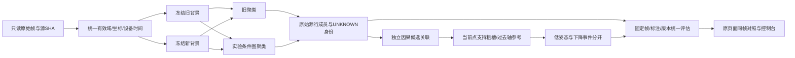

# HFUS-PARALLEL-RESEARCH-01：四线路并行研究与架构建议

日期：2026-10-14（Asia/Shanghai）。状态：SUBMITTED，研究交付；未实现新算法，未替换默认，未进行设备验收。

用户本轮要求四线路并行、联网深搜相关算法、代码、架构。主控负责架构与比较契约，三个只读助手分别负责背景异常、聚类身份、骨架事件。四条研究线路已并行执行。此报告是后续实施建议，不接管历史工单，不以本轮研究替代 SSE-06～08 验收。

## 1. 最重要的结论

推荐先做新旧背景全量对照，再做有条件的体素图聚类与独立因果关联，最后评价粗骨架和倒地事件。优先复用现有源行映射、局部背景面、静态锚点和过去强观测参考。没有证据表明整套深度网络或SLAM能够直接解决当前问题。

新背景89.8%改善是背景残留减少，不是新聚类或人体准确率提高；聚类、人体身份、骨架和跌倒四种结论必须分别验证。联网核查还发现多处论文宣称有代码、作者仓库实际上仍为Coming Soon，不列为现成实现。

## 2. 当前架构与实际代码

| 链路 | 当前实际实现 | 需要保留的契约 |
|---|---|---|
| 原始动作输入 | actions.load：28B步长、连续帧offset、单调设备时间、meta/points SHA；只读memmap | frame-local原始源行，原XYZ与字节可追溯 |
| 坐标与背景 | 历史R/T和每会话注册；冻结空场体素背景；最近背景距离；scene_change局部平面+活动区外静态锚点小刚体补偿 | 历史变换不是新物理标定；拒绝退化/过大/残差变差的补偿 |
| 实验页聚类 | core.cluster：5cm体素中心→三维sklearn DBSCAN，eps=.17m、min_samples=4→原始成员→至少25点 | voxel只供邻域/连接，输出必须回原始行，不能生成或跨帧叠加测量点 |
| 中央候选 | actions.choose：至少300点、ROI比例、尺寸、P90及上一中心距离打分 | 几何候选不是人体分类，UNKNOWN保持 |
| 粗骨架与事件 | 当前点支持的13槽PCA区域中心；过去可靠轴符号；Posture高度/速度/持续低姿态 | 13槽不是已标定解剖关节；显示平滑与当前测量分开 |
| 页面/控制台 | pointset server按dataset/variant读取冻结产物；console动态启动pointset/r01与real_fall/r04 | 原页增加对照，原默认与历史产物保留；页面只渲染，不承担算法 |
| 生产HF | lidar_candidates._connected_clusters为地面水平坐标网格连通；tracking/fall_state有自己的资格与状态门 | 不能把离线3D DBSCAN收益算作生产改进，不能绕过生产门 |

R2/R3主要实验旧聚类之后的点集恢复、局部方向和历史参考，不是整体替换聚类器。R3加点/符号改善仍伴随新困难帧、粗槽跳变，完整人体/家具身份尚未验证。

## 3. 四条线路与依赖

| 线路 | 独立开展的工作 | 第一份可审查产物 | 依赖/写入边界 |
|---|---|---|---|
| L1 背景与异常点 | 新背景1934帧对照设计；地下点原始坐标、地面相对高度、空间方位与镜像假设诊断；补偿失败分支 | 每帧背景成员变化、异常点源行表、补偿质量分布 | 输入只读，不改聚类、原始XYZ或旧背景 |
| L2 聚类与人体身份 | 固定输入对比DBSCAN与有条件图连接；定位人体断裂/家具桥接；建立独立标注队列 | 完整源成员对照、困难帧、语义未知比例、CPU/内存报告 | 用冻结L1结果；暂不改tracker与骨架；正式身份指标需要独立GT |
| L3 骨架与事件 | 固定旧点集评估轴与节点；因果符号参考；下降过程与持续低姿态分开 | 轴/槽稳定性和事件负例表、前缀一致性 | 可先用旧输入并行，L1/L2完成后再对相同版本重新评分 |
| L4 对比、审核与集成 | 数据/坐标/源行/版本契约、A/B/C/D比较矩阵、标注协议、页面交付方案 | 可复现manifest、验收表、同帧页面比较设计 | 主控统一收口；共享server/app/权威状态文档只由集成writer改 |

研究和独立实验可以并行；串接验证必须等上游版本冻结。遵守每工单一个production writer；不能让多条线路同时改core.py/actions.py/server.py。当前三个助手全程只读，主控只写本次研究记录。

PC实验目前已有SciPy/sklearn依赖；板端候选必须另做stdlib+NumPy、Python3.8/NumPy1.17兼容验证。只读研究不将PC代码直接部署板端。

## 4. 聚类、关联与架构算法筛选

以下均是作者/项目官方来源。许可证结论只描述本次看到的声明，不代替引入时逐文件核查；模型、数据、子模块许可分别处理。

| 方法与实际代码 | 核查结果 | 本项目取舍 |
|---|---|---|
| [PCL条件欧式聚类源码](https://github.com/PointCloudLibrary/pcl/blob/master/segmentation/include/pcl/segmentation/impl/conditional_euclidean_clustering.hpp)；[官方教程](https://pointclouds.org/documentation/tutorials/conditional_euclidean_clustering.html) | segment在半径搜索后用条件函数决定图边；C++/PCL、BSD声明 | 首选借鉴：体素图边加对称、局部密度和背景接触条件。稀疏部位法向不稳，不能强制相同法向。复用已有图遍历，不引整套PCL |
| [距离自适应聚类](https://github.com/yzrobot/adaptive_clustering/blob/master/src/adaptive_clustering.cpp) | pointCloudCallback分量程环、递增容差、PCL EuclideanClusterExtraction；根LICENSE BSD-3-Clause，源码头部GPLv3或later，声明冲突 | 借算法思路，暂不复制代码。原Velodyne量程分环不能照搬IFW192S；注意环边界碎裂 |
| [HDBSCAN源码](https://github.com/scikit-learn-contrib/hdbscan/blob/master/hdbscan/hdbscan_.py)；[构建依赖](https://github.com/scikit-learn-contrib/hdbscan/blob/master/pyproject.toml) | BSD-3-Clause；当前Python≥3.10、NumPy≥1.20、SciPy、sklearn≥1.6及编译构建 | PC影子对照候选；当前版不适板端。变密度聚类仍不能提供人体身份；保守参数可能删除稀疏手脚 |
| [PointNet++作者代码](https://github.com/charlesq34/pointnet2/blob/master/models/pointnet2_cls_msg.py)；[论文](https://arxiv.org/abs/1706.02413) | 多尺度局部集合抽象，MIT；原TF1.2与CUDA自定义算子；现成分类训练面向ModelNet40 | 后续PC研究；需真实身份标签和会话划分，不能直接拿物体分类权重认室内低姿态人体 |
| [ByteTrack官方源码](https://github.com/FoundationVision/ByteTrack/blob/main/yolox/tracker/byte_tracker.py)；[匹配模块](https://github.com/FoundationVision/ByteTrack/blob/main/yolox/tracker/matching.py) | MIT；高低分两阶段关联，公开实现处理2D框，torch/scipy/lap/cython_bbox/OpenCV等 | 借弱观测只延续已有可靠身份的思想，保持歧义失效；几何分数不是人体概率。整套实现不适板端 |
| [AB3DMOT作者实现](https://github.com/xinshuoweng/AB3DMOT)；[KF代码](https://github.com/xinshuoweng/AB3DMOT/blob/master/AB3DMOT_libs/kalman_filter.py)；[LICENSE](https://github.com/xinshuoweng/AB3DMOT/blob/master/LICENSE) | 3D Kalman+Hungarian；源码依赖filterpy，仓库许可限制非商业研究 | 比较架构参考，优先复用本仓tracker。固定车载框状态和固定步长不直接适合可变帧间隔/人体形变 |
| [Livox Detection官方](https://github.com/Livox-SDK/livox_detection) | CenterPoint启发的anchor-free检测；PyTorch/CUDA/ROS/OpenPCDet；发布模型与GPU性能说明 | 汽车场景和扫描设备分布不同，不能以公开GPU帧率推断IFW/板端效果；不是当前最小修复 |
| [O-LiPeDeT作者仓库](https://github.com/nilushacj/O-LiPeDeT-Overhead-LiDAR-Person-Detection-and-Tracking)；[2026原文](https://arxiv.org/abs/2603.04938) | 室内顶部LiDAR站点适配、检测+tracking、按距离分层；根MIT但依赖OpenPCDet/AB3DMOT等；NVIDIA CUDA要求，数据/权重链接存在未下载 | 学习公平站点适配/距离分层评估；顶部视角与本机侧视场不同，框标注不能验证逐点纯度 |

固定eps会在稀疏末端碎裂、近接家具处连通，这属于算法风险推断，尚未被本轮新实验验证。优先先定位真实图桥接/断边，再测试局部尺度和条件连接；不同时调背景、ROI、选择器与时序。

## 5. 骨架与事件路线

### 背景与地下异常点补充筛选

当前scene_change已经有局部PCA面、小刚体最小二乘、残差截断、秩/包络/残差门及双姿态解释。先复用；现有高度域仍可能丢近地点，应逐点记删点原因，不能为去地下点新增一刀切高度过滤。

| 方法/实际作者代码 | 核查结果 | 使用建议 |
|---|---|---|
| [KISS-ICP论文](https://arxiv.org/abs/2209.15397)、[Registration.cpp](https://github.com/PRBonn/kiss-icp/blob/main/cpp/kiss_icp/core/Registration.cpp) | MIT；Geman–McClure鲁棒权重/对应距离门/SE3迭代，C++ Eigen/Sophus/TBB与Python绑定 | 只借加权6×6解算作独立消融；现有残差截断已有保护，加权收益待测，不引全SLAM |
| [ERASOR作者仓库](https://github.com/LimHyungTae/ERASOR) | 已核查erasor.cpp，GPLv3、C++17/ROS1/PCL，伪占据比与离线地图清理 | 动态物体清图目标与保留人体相反，地面恢复也可能删除低姿态；只作旁路研究 |
| [Removert作者源码](https://github.com/gisbi-kim/removert/blob/master/src/Removerter.cpp) | 多分辨率range image；README声明CC BY-NC-SA4.0，ROS/PCL/OpenCV/OpenMP | 借可见性/遮挡反证作诊断；多扫描离线地图不能冒充在线因果 |
| [ETRI论文记录](https://ksp.etri.re.kr/ksp/article/read?id=72361)、[lidar_fix作者代码](https://github.com/GuideDog-ETRI/lidar_fix/blob/main/src/lidar_fix_node.cpp) | 2026室内亮地面镜像反射；package.xml BSD-3-Clause但未找到独立LICENSE；ROS2/OpenCV，64×1024 Ouster扫描假设 | 最贴近地下鬼点诊断；借XYZ相对平面镜像、强度/距离匹配。不要照搬把鬼点投影地面改变XYZ的输出 |
| [GRASS论文](https://www.mdpi.com/2072-4292/18/2/332)、[作者仓库](https://github.com/wpshao/GRASS) | 多回波玻璃识别研究；实际仓库仅README与2870B Markdown文本，无算法源码/依赖/许可 | 不能列可运行开源实现；当前28B格式未见echo编号，ring不是回波数 |

异常点旁路诊断建议：原始XYZ→当前变换→可信地面/玻璃平面候选→镜像对应距离、强度比、形状一致性与过去支持→SUSPECT_REFLECTION/UNKNOWN。先显示证据，不删点、不生成修正XYZ。物理平面或对应不足则保持UNKNOWN；静态反射也可以稳定，时间稳定不是表面真实的证明。本轮没有锁定截图对应sid/fi，不能确定截图原因。

actions.Posture已用设备时间、高度分位数、下降速度与低姿态持续时间。但DOWN_POSTURE_CANDIDATE只要求曾站立和持续低姿态；下降速度目前并不是该事件必要证据。因此保持两个输出：持续低姿态/倒地姿态候选，以及有此前下降过程的事件候选。快速下降与缓慢下降可分通道，不能用单一高速门漏掉缓慢跌落；也不能直接宣称能够区分主动躺下与意外跌倒。

轴符号优先保留当前同身份、过去强观测、有期限参考；节点必须有当前源点支持。换身份/设备时间回退/缺测超时断开事件链。real_fall/r04的display_xyz和平滑淡出不能当测量；其历史初始f0–3未来初始化不能当因果基线。

| 方法 | 论文/官方代码 | 实际可用性与适配 |
|---|---|---|
| LiDARCap | [原文](https://arxiv.org/abs/2203.14698)、[作者代码](https://github.com/jingyi-zhang/LiDARCap) | Apache2.0；PointNet++/时序/SMPL，PyTorch1.8.1 CUDA11.1和编译扩展；权重链接存在，未下载。PC影子候选，板端不适配 |
| LiveHPS | [原文](https://arxiv.org/abs/2402.17171)、[作者代码](https://github.com/4DVLab/LiveHPS)、[时序源码](https://github.com/4DVLab/LiveHPS/blob/main/Model/livehps.py) | MIT；测试32帧×256点，torch/PyTorch3D/SciPy。代码GRU为bidirectional，Transformer未见因果mask；整窗离线输出不可冒充实时因果。仅过去窗口末帧方案需另测精度/时延 |
| LiDAR-HMR | [原文](https://arxiv.org/abs/2311.11971)、[作者代码](https://github.com/soullessrobot/LiDAR-HMR) | 稀疏关节→稠密网格Graph Transformer，编译扩展与torch/Open3D；权重链接存在未下载；首页未找到LICENSE，复用许可未核实，低优先级 |
| LidPose | [论文原文](https://pmc.ncbi.nlm.nih.gov/articles/PMC11174988/) | 稀疏Livox Avia球面range image与ViTPose，未找到可核查作者代码/权重。算法参考，非现成实现 |
| LiDAR轻量跌倒FSM | [作者机构论文页](https://researchers.unab.cl/en/publications/low-cost-lidar-based-monitoring-system-for-fall-detection/)、[另一项原文](https://ietresearch.onlinelibrary.wiley.com/doi/10.1049/htl2.12001) | 支持轻量事件层及长时间低姿态分开评价的思路；测距单元/房间逻辑与IFW三维点云不同，不能移用准确率 |
| 图谱HAR | [2025原文](https://arxiv.org/abs/2509.23255)、[作者仓库](https://github.com/Arritmic/oulu-pointcloud-har) | epsilon图、谱统计和滑窗分类的研究思路；仓库当前仅README/LICENSE，Code coming soon，不能列可运行算法 |
| HuLiGen | [2026-10原文](https://arxiv.org/abs/2610.10196)、[作者仓库](https://github.com/valeoai/HuLiGen) | 参数人体生成LiDAR的预训练思路；当前仅README，Code Release Coming Soon；不启合成训练，不把合成数据当真实GT |

多数姿态网络要求先得到单人点云，不能代替线路2解决家具粘连；SMPL、外部数据与预训练权重条款需单独核查。当前无解剖GT，不报告MPJPE/PCK；八段短动作也不足以估计长期误报/小时。

## 6. A/B/C/D对照与评价契约

| 组 | 背景 | 聚类 | 对照解释 |
|---|---|---|---|
| A | 冻结旧背景 | 旧3D DBSCAN | 实验页基线；旧空场原文件缺失的CAL重核验仍BLOCKED |
| B | 冻结新背景 | 旧3D DBSCAN | B-A隔离背景影响 |
| C | 冻结旧背景 | 新条件图 | C-A隔离聚类影响 |
| D | 冻结新背景 | 新条件图 | D-B评价新背景条件下聚类影响，D-C评价新聚类条件下背景影响 |

另外登记生产二维网格链路为独立P组，不能拿其配置与A组混称同一个旧聚类。A/B/C/D固定同一1934帧原始输入、R/T和注册、有效域、ROI、候选选择、tracker、时间重置、设备时间；旧32留出和新90留出分开记。旧背景冻结artifact可对照，不伪造旧原始空场或重标CAL。

分两层评分：固定R1锚点诊断成员变化，然后每方案独立从头运行因果tracker评价端到端副作用；禁止把旧winner直接当新方案成功。FIT/CAL冻结，不用HOLDOUT调参数；当前开发反复使用的八段只叫回归/开发集，不能改名未见泛化集。

| 层级 | 有证据可评价的指标 | 必要边界 |
|---|---|---|
| 输入/源行 | SHA/XYZ、成员互斥、背景+前景+拒绝守恒、当前帧支持、前缀重放 | 任何源错配先失败，不靠显示看起来正确 |
| 背景 | 留出残余、簇数、背景误晋升、候选点保留、近地删点、补偿失败比例 | 原候选保留率不是人体召回；同连续会话留出不等于跨会话泛化 |
| 语义点集 | 可判定标注点上的precision/recall/IoU；UNKNOWN比例；碎裂/家具粘连 | GT带sid/fi/源SHA/源行/审核来源，AI视觉假设与自动ROI参照单列 |
| 关联 | 候选缺测、断轨、错误重绑定/ID切换、遮挡后恢复 | 跨算法簇ID不能直接逐值比较；缺GT不报真人身份准确率 |
| 粗骨架 | 轴缺测、无向轴角变化、符号翻转、当前槽支撑、槽跳变P50/P95 | 显示平滑另列，不填旧点/虚拟节点提高支撑率 |
| 事件 | 事件召回、重复警报、报警延迟、负例误报；长会话误报/小时 | 真实跌倒与受控躺下分开；初始躺地、慢躺、蹲坐、弯腰、跪地、家具接触、出入视场、遮挡重现必测 |
| 性能 | CPU耗时P50/P95、峰值内存、按会话/点数/距离分层 | PC数据不能推成板端FPS；源码3.8兼容与板端运行分开验收 |

困难帧优先沿R2/R3现有f119/f140/f232及符号返工f124建立源绑定队列，同时加入未由开发挑选的会话留出。没有独立身份GT时先报成员差异/几何诊断，不虚构语义指标。

## 7. 推荐实施次序与当前状态

1. L4冻结输入manifest与比较契约，同时L1完成A/B全帧；L2离线研究图桥接，L3以旧固定输入跑稳定性/事件诊断。
2. 确认A/B有无低姿态吞点和关联退化后，L2只引入一个最小条件图变体做C/D；法向、距离自适应分别消融。
3. L3对同版本点集重新评分，再对已知事件问题做独立返工，不把上游收益与平滑收益混合。
4. L4同页对照、独审和控制台源码/EXE一致性验证；设备/部署另按当前明确授权。当前不默认晋级，不启动HR-09。

本轮新算法实际效果、A/B/C/D全量结果、设备/物理、生产晋级均NOT_RUN。独立语义/关节GT不足；旧131958原始CAL重核验BLOCKED。这些状态不因联网找到算法而改变。

## 8. 检索、基线与技能记录

- 实际查询arXiv REST：见ARXIV_QUERY.json及完整ARXIV_RAW.xml（12项，含不相关召回）；另用web检索作者论文、官方GitHub、源代码和LICENSE。不是穷尽式系统综述。
- 本地相关生产与实验源（含未跟踪）哈希：SOURCE_BASELINE.json；全仓状态清单：GIT_STATUS_BEFORE.txt。此为相关源保护快照，不声明整树冻结。
- 主控及三助手ponytail实际路径：C:/Users/30680/.codex/skills/ponytail/SKILL.md。
- 主控paper-lookup：C:/Users/30680/.codex/skills/scientific-toolkit-skill/references/scientific-skills/paper-lookup/SKILL.md，实际读取references/arxiv.md。
- 数据/历史产物/模型/生产源码只读，无训练、采集、部署、依赖安装、重打EXE或Git提交推送。新文件仅本轮证据及回传。
